# Handleiding Leeravontuur

Leeravontuur is een gratis leerprogramma van **Solve It Now** ("Iedereen moet kunnen leren") voor kinderen in
Vlaanderen. Deze handleiding is voor de ouder en de leerkracht: wat elk onderdeel leert, welke keuzes er zijn,
hoe je iets doet en wat het programma herkent als het kind een denkfout maakt.

De schermafdrukken zijn echte beelden van het programma (80 × 24 tekens), met het voorbeeldkind Imrane uit het
5de leerjaar. Bij jou kunnen de getallen in de vragen anders zijn: elke vraag wordt nieuw gemaakt.

## Inhoud

**Starten en de basis** (deze pagina)
- [Starten en een kind kiezen](#starten-en-een-kind-kiezen)
- [Het hoofdmenu](#het-hoofdmenu)
- [Bedienen: toetsen en muis](#bedienen-toetsen-en-muis)
- [Een onderwerp kiezen](#een-onderwerp-kiezen)
- [Niveaus: Makkelijk tot Heel moeilijk](#niveaus-makkelijk-tot-heel-moeilijk)
- [Vrij oefenen](#vrij-oefenen)
- [Een reeks van 10 en fouten opnieuw](#een-reeks-van-10-en-fouten-opnieuw)
- [Punten](#punten)

**Deel 1: Wiskunde**
1. [Eenheden](wiskunde/eenheden.md): lengte, massa, inhoud, oppervlakte en volume omzetten, met de eenhedentabel
2. [Hoofdrekenen](wiskunde/hoofdrekenen.md): tafels, plus en min, × en : met 10/100/1000, verdubbelen en halveren
3. [Getallen](wiskunde/getallen.md): plaatswaarde, afronden, deelbaarheid, de getallenlijn
4. [Cijferen](wiskunde/cijferen.md): optellen, aftrekken en vermenigvuldigen onder elkaar, de staartdeling
5. [Breuken](wiskunde/breuken.md): de breukbalk, vereenvoudigen, vergelijken, optellen, breuk van een getal
6. [Procenten](wiskunde/procenten.md): het honderdveld, procent van een getal, korting en btw
7. [Tijd, geld en snelheid](wiskunde/tijd-geld-snelheid.md): de klok, uren en minuten, wisselgeld, km/u
8. [Meetkunde](wiskunde/meetkunde.md): oppervlakte en omtrek, formules, hoeken, de schatkaart, schaal
9. [Vraagstukken](wiskunde/vraagstukken.md): verhaaltjes in 4 stappen (lezen, plannen, rekenen in het klad,
   controleren), met tips en een tweede kans

**Deel 2: de rest van het programma**
- [Snelrekenen](snelrekenen.md)
- [Herhalen (de herhaalbak)](herhalen.md)
- [Mijn avatar en de winkel](avatar-en-winkel.md)
- [Spiekbrieven](spiekbrieven.md)
- [Opties](opties.md)
- [Zeg het ons](zeg-het-ons.md)
- [Het ouderdeel](ouderdeel.md): rapporten, kinderen, punten, wachtwoord, opmerkingen
- [Startargumenten](startargumenten.md): alle opties om het programma te starten
- [Problemen oplossen](problemen-oplossen.md): gegevens, reservekopieën, foutenlogboek

---

## Starten en een kind kiezen

Start het programma met `python3 oefeningen.py` in de map van het programma (op Windows: `python oefeningen.py`,
of dubbelklik op de snelkoppeling). Hoe je het installeert, staat in de [README](../../README.md).

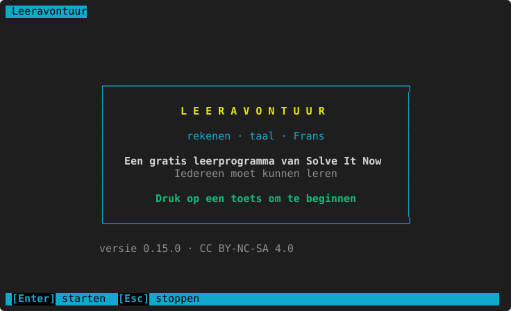

Druk op een toets (of Enter). Daarna kies je wie er oefent:

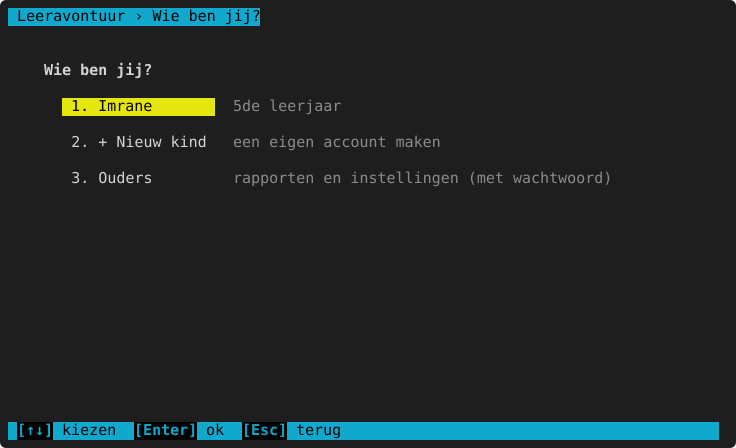

- Kies je eigen naam. Heeft de ouder een **pincode** ingesteld voor dat kind, dan vraagt het programma die eerst.
- **+ Nieuw kind**: een eigen account maken met een naam en een leerjaar. Elk kind heeft zijn eigen punten,
  avatar, instellingen en vooruitgang.
- **Ouders**: het [ouderdeel](ouderdeel.md), met een wachtwoord.

## Het hoofdmenu

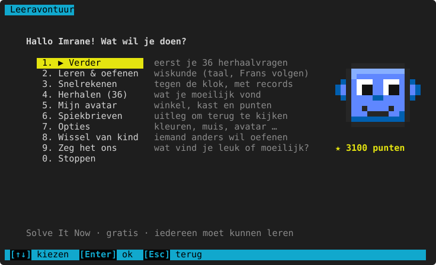

| Keuze | Wat het doet |
|---|---|
| **1. ▶ Verder** | Gaat verder waar je gebleven was. Staan er herhaalvragen klaar, dan eerst die. Ernaast staat wat er komt. |
| **2. Leren & oefenen** | Een vak, een domein en een onderwerp kiezen (zie hieronder). |
| **3. Snelrekenen** | Tegen de klok rekenen, met records. Zie [Snelrekenen](snelrekenen.md). |
| **4. Herhalen (n)** | De vragen die je moeilijk vond, met nieuwe getallen. Het getal = hoeveel er vandaag klaarstaan. Zie [Herhalen](herhalen.md). |
| **5. Mijn avatar** | Je avatar, de winkel, je kast en je punten. Zie [Mijn avatar en de winkel](avatar-en-winkel.md). |
| **6. Spiekbrieven** | De uitleg van elk domein om terug te lezen. Zie [Spiekbrieven](spiekbrieven.md). |
| **7. Opties** | Kleuren, muis, avatar, typrichting … Zie [Opties](opties.md). |
| **8. Wissel van kind** | Terug naar "Wie ben jij?". |
| **9. Zeg het ons** | Schrijf wat je leuk, moeilijk of kapot vindt. Zie [Zeg het ons](zeg-het-ons.md). |
| **0. Stoppen** | Het programma sluiten. Alles is al bewaard. |

Rechts staat je **avatar** met je **punten**. Bovenaan rechts staat na een tijdje **Vandaag: x/y juist**.

## Bedienen: toetsen en muis

Bovenaan staat de **kruimel**: waar je bent (bv. `Leeravontuur › Leren › Wiskunde › Breuken`). Onderaan staat de
**knoppenbalk** met de toetsen die nu werken. Elke knop kun je ook **aanklikken**.

| Toets | Wat het doet |
|---|---|
| `↑` `↓` of het scrollwiel | Een keuze kiezen in een menu; scrollen in een lange tekst. |
| `Enter` | Kiezen, een antwoord nakijken, naar de volgende vraag. |
| Een cijfer (`1` … `9`, `0`) | Meteen die keuze in een menu. |
| `Esc` | Terug (een menu hoger), of stoppen met oefenen. |
| `?` | Een tip bij de vraag (bij cijferen: hulp bij het vakje waar je staat). |
| Muisklik | Een keuze, een knop, een vakje, een stuk van de breukbalk, een streepje op de getallenlijn … |

Kommagetallen typ je met een **komma**: `0,25` (een punt mag ook). Een negatief getal met een min: `-5`.
Een eenheid achter je antwoord mag (`3,5 km`), het programma kijkt alleen naar het getal.

> Werkt de muis niet goed, of wil je tekst selecteren om te kopiëren? Zet de muis uit bij [Opties](opties.md) of
> start met `--geen-muis` (zie [Startargumenten](startargumenten.md)).

## Een onderwerp kiezen

**Leren & oefenen → Wiskunde** toont de domeinen:

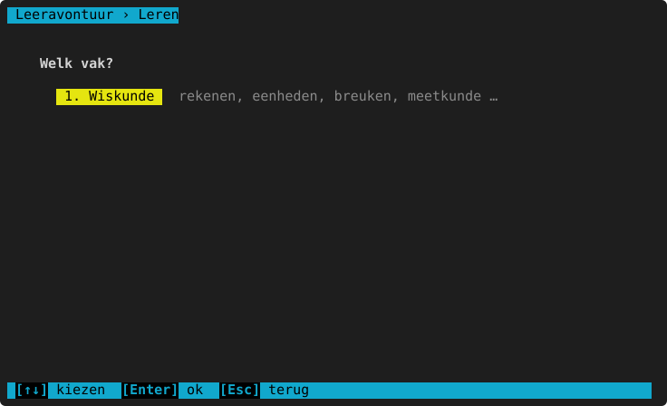
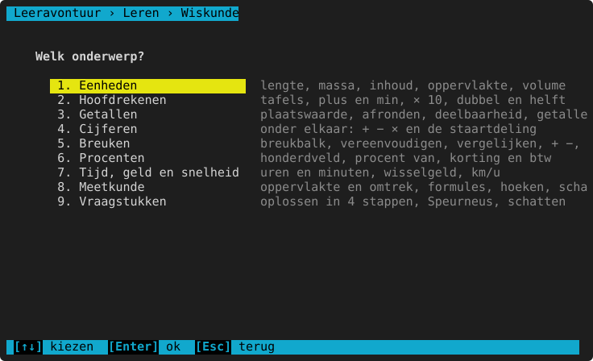

Elk domein heeft zijn onderwerpen, bv. bij Hoofdrekenen:

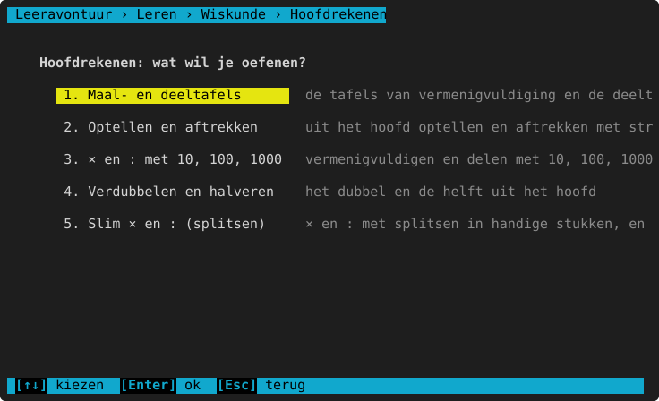

Dan kies je **hoe** je oefent:

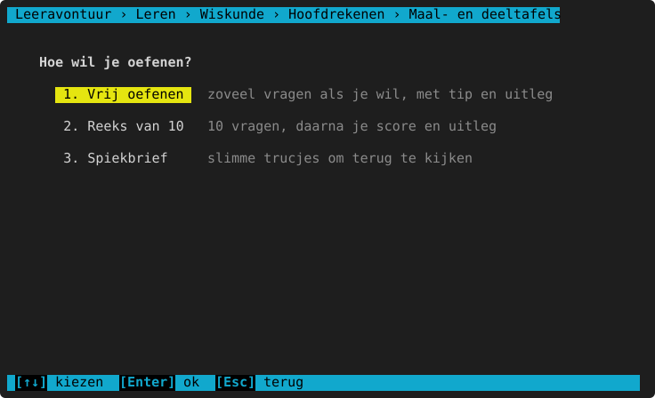

- **Vrij oefenen**: zoveel vragen als je wil. Na elk antwoord krijg je meteen uitleg.
- **Reeks van 10**: 10 vragen na elkaar; op het einde je score en uitleg bij elke fout.
- **Spiekbrief**: de uitleg van het domein (hetzelfde als bij [Spiekbrieven](spiekbrieven.md)).

Eenheden heeft een eigen scherm met ook een **tabel-oefening**; zie [Eenheden](wiskunde/eenheden.md).

## Niveaus: Makkelijk tot Heel moeilijk

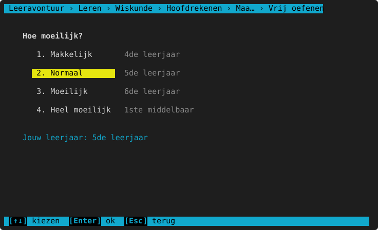

De niveaus zijn **relatief tegenover het leerjaar van het kind**:

| Niveau | Vragen van | Punten per juist antwoord |
|---|---|---|
| Makkelijk | een leerjaar lager | 5 |
| Normaal | het eigen leerjaar | 10 |
| Moeilijk | een leerjaar hoger | 15 |
| Heel moeilijk | twee leerjaren hoger | 20 |

Het leerjaar van het kind stelt de ouder in (ouderdeel → Kinderen). Bestaat een onderwerp nog niet in een
leerjaar, dan staat er "(nog niet in dit leerjaar)" en kun je dat niveau niet kiezen. Wat er per leerjaar aan bod
komt, staat bij elk onderwerp in een tabel **Per leerjaar**.

## Vrij oefenen

Elke vraag staat links; rechts kijkt het **oefenmaatje** (je avatar) mee. Typ je antwoord en druk Enter.

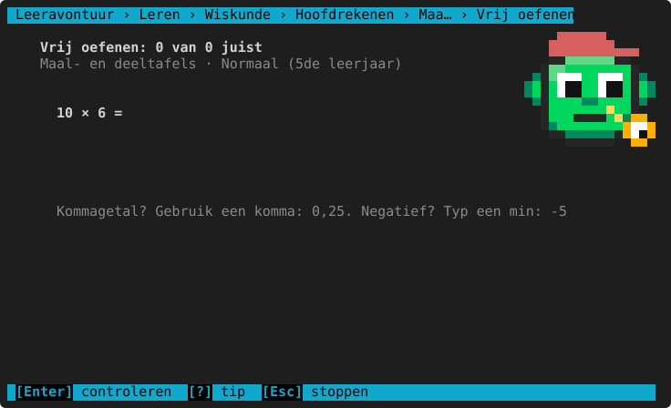

- Met `?` krijg je een **tip**, zonder het antwoord te verklappen:

  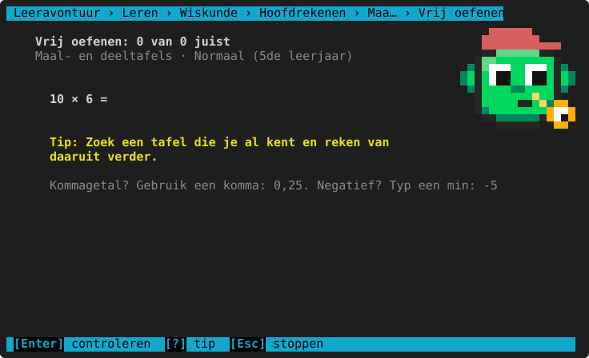

- Juist: ✔, punten en een korte uitleg (een handige manier om het te onthouden):

  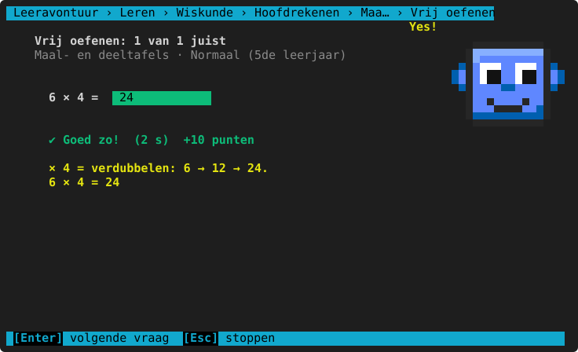

- Fout: ✘, het juiste antwoord en de uitleg stap voor stap. Herkent het programma een **denkfout**, dan staat die
  er eerst bij (bij elk onderwerp staat welke denkfouten het herkent). Het maatje geeft een kleine hint.

  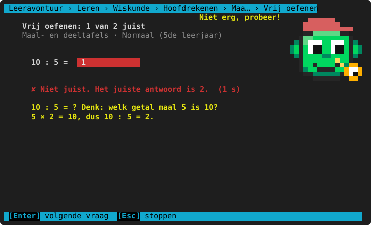

Juist en fout hebben altijd ook een teken (✔ ✘ !), niet alleen een kleur: zo werkt het ook met een
kleurenblind-thema. Met `Enter` ga je naar de volgende vraag, met `Esc` stop je. Een fout onderwerp komt in de
[herhaalbak](herhalen.md).

## Een reeks van 10 en fouten opnieuw

Bovenaan zie je hoeveel vragen je al had (● juist of fout, ◉ waar je nu bent).

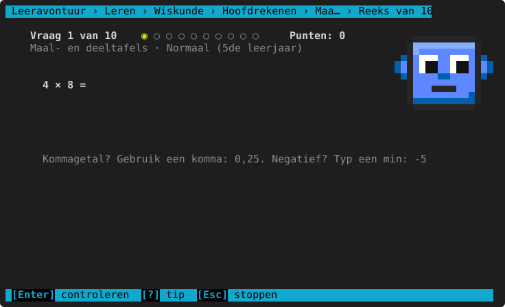

Na de reeks: je score, je punten, je gemiddelde tijd en bij elke fout wat je schreef, het juiste antwoord en de
uitleg (scrollen met `↑` `↓`).

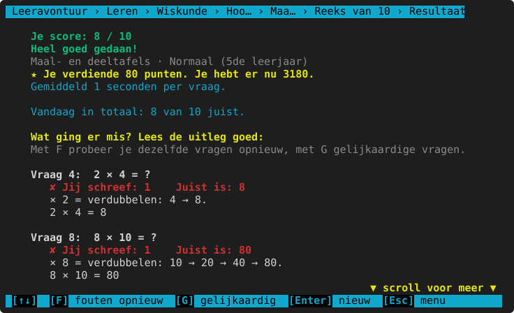

- `F` (**fouten opnieuw**): precies dezelfde vragen nog eens (voor de helft van de punten).
- `G` (**gelijkaardig**): dezelfde soort vragen met nieuwe getallen.
- `Enter`: een nieuwe reeks. `Esc`: terug naar het menu.

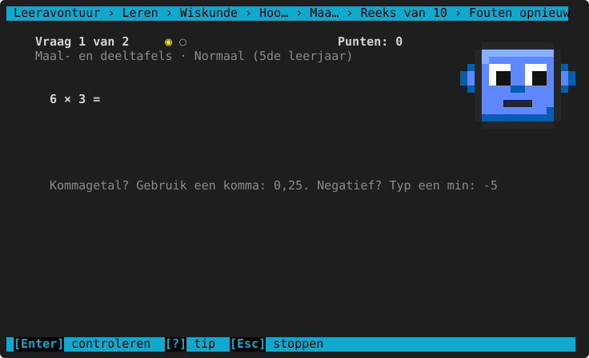

Stop je een reeks in het midden met `Esc`, dan blijven de antwoorden die je al gaf bewaard.

## Punten

| Wat | Punten |
|---|---|
| Een juist antwoord | 5 (Makkelijk), 10 (Normaal), 15 (Moeilijk), 20 (Heel moeilijk) |
| Een vraag die je al eens juist had | 0: zo kun je niet "punten kweken" |
| Fouten opnieuw (dezelfde vragen) | de helft |
| De eenhedentabel helemaal juist (cijfers en komma) | +5 |
| 5 juist op rij | +10 |
| Een reeks van 10 zonder fout | +20 |
| Een onderwerp beheerst in de herhaalbak | +15 |

Met punten koop je dingen voor je avatar in de [winkel](avatar-en-winkel.md). De ouder ziet elk punt in het
puntenlogboek en kan bonuspunten geven ([ouderdeel](ouderdeel.md)).
