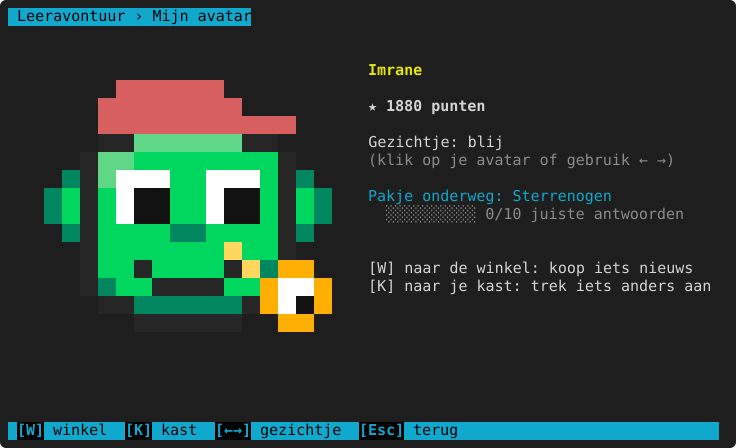
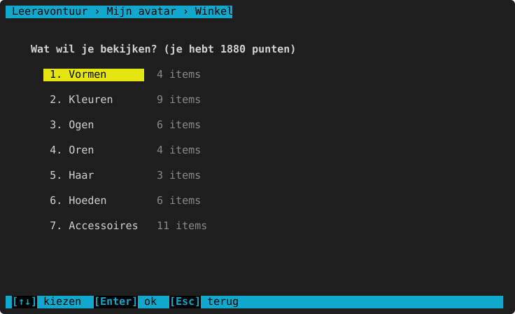
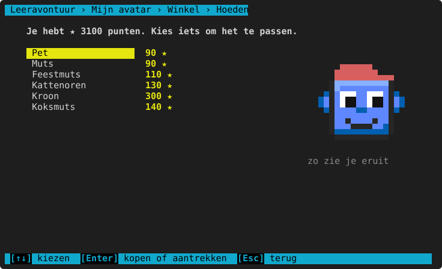
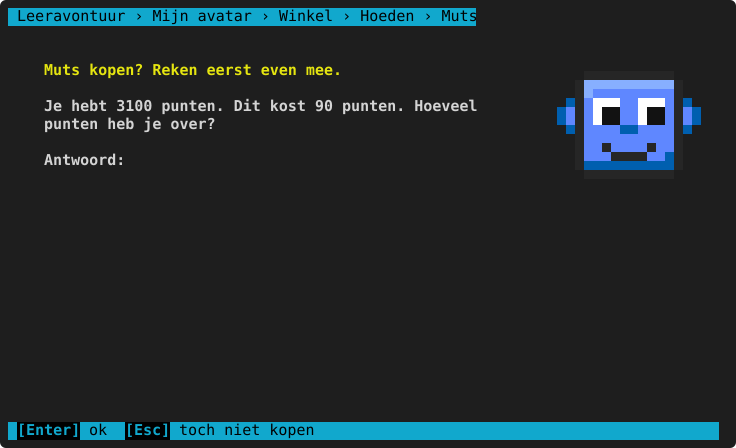
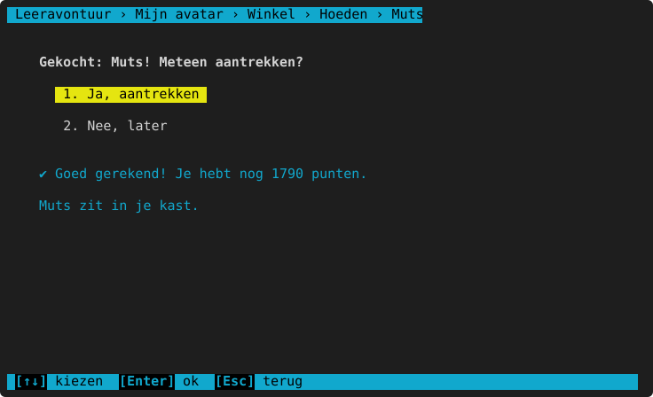
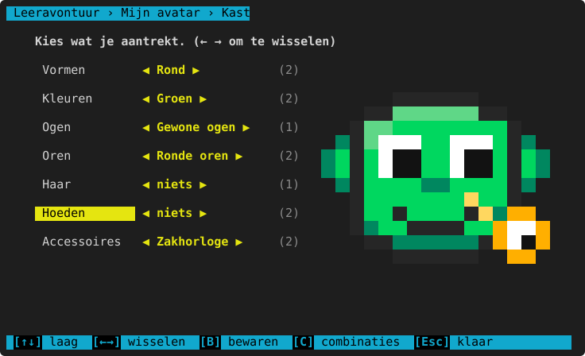
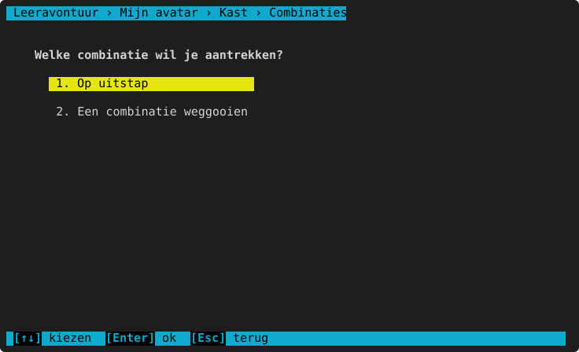

# Mijn avatar en de winkel

**Waar:** hoofdmenu → **5. Mijn avatar** · [← terug naar de inhoud](README.md)

Elk kind heeft een eigen **avatar**: een gezichtje in pixel-art dat in het hoofdmenu staat en als **oefenmaatje**
meekijkt tijdens het oefenen (blij bij een juist antwoord, met een kleine hint bij een fout). Met punten koop je
nieuwe dingen in de winkel.

- `←` `→` (of een klik op de avatar): de gezichtjes bekijken (blij, trots, verrast, denken …).
- Een **pakje onderweg** staat er met een balkje: hoeveel je nog moet oefenen tot het aankomt.
- `W`: naar de **winkel**. `K`: naar je **kast**. `Esc`: terug.

## De winkel

Er zijn vormen, kleuren, ogen, oren, haar, hoeden en accessoires. Kies een soort, en dan een item: rechts zie je
meteen hoe je eruitziet ("passen"). Bij elk item staat de prijs (★), of "✔ in je kast" of "pakje onderweg".

### Kopen: eerst even rekenen

Bij elke aankoop stelt de winkel een **rekenvraag**: "Je hebt 3100 punten. Dit kost 90 punten. Hoeveel punten heb
je over?" Vanaf het 5de leerjaar is er soms **korting** (10 %, 20 %, 25 %, 50 %; vanaf het 6de ook 15 %, 30 %,
40 %): dan reken je eerst de prijs uit. Heb je te weinig punten, dan vraagt de winkel hoeveel je nog moet sparen.

- **Juist**: het item zit meteen in je kast, en je mag het aantrekken.
- **Fout**: "Ben je zeker?" en nog één kans.
- **Nog eens fout**: een **mini-lesje** met de uitleg, en dan een ludieke straf die de ouder kiest
  ([ouderdeel](ouderdeel.md) → Kinderen → "Winkel: 2x een foute som"):

  | Straf | Wat er gebeurt |
  |---|---|
  | pakje komt na 10 juiste antwoorden (standaard) | "De koerier is verdwaald": het item komt pas na 10 juiste antwoorden. |
  | pakje komt na 15 minuten oefenen | Het item komt na 15 minuten oefenen. |
  | 5 punten verzendkosten | Het item komt meteen, maar kost 5 punten extra. |
  | geen straf | Het item komt meteen. |

De punten zijn altijd betaald, ook als het pakje later komt.

## De kast

- `↑` `↓`: een laag kiezen (vorm, kleur, ogen …). `←` `→` (of een klik op ◀ ▶): iets anders aantrekken. Tussen
  haakjes staat hoeveel je er hebt.
- `B`: je huidige kleren **bewaren** als combinatie (met een naam).
- `C`: **combinaties**: een bewaarde combinatie aantrekken, of er een weggooien.

Wil je geen avatar of geen bewegende avatar (springen bij een juist antwoord)? Zet hem uit bij [Opties](opties.md).

> **Voor het kind:** Spaar voor iets moois! Je verdient punten met juiste antwoorden, met 5 juist op rij en met
> een reeks zonder fouten. Een vraag die je al eens juist had, levert niets meer op.
