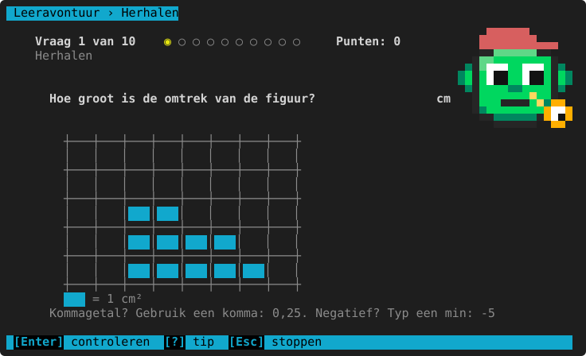

# Herhalen (de herhaalbak)

**Waar:** hoofdmenu → **4. Herhalen (n)**, of **1. ▶ Verder** · [← terug naar de inhoud](README.md)

Wat het kind fout had, komt de volgende dagen terug: niet dezelfde vraag, maar **een gelijkaardige met nieuwe
getallen**. Zo leert het kind de regel en niet het antwoord. Het getal tussen haakjes in het hoofdmenu is hoeveel
vragen er vandaag klaarstaan. Staan er vragen klaar, dan begint **▶ Verder** daar eerst mee.

## Hoe het werkt

Het programma gebruikt een **herhaalbak** (het systeem van Leitner) per onderwerp, bv. "km naar m" of "tafel 7":

| Wat gebeurt er? | Gevolg |
|---|---|
| Het kind heeft een onderwerp fout (bij oefenen of herhalen) | Het gaat naar **bak 1** en komt **morgen** terug. |
| Juist in bak 1 | Naar bak 2: terug over **3 dagen**. |
| Juist in bak 2 | Naar bak 3: terug over **7 dagen**. |
| Juist in bak 3 | **Beheerst**: het verdwijnt uit de herhaalbak (+15 punten). |
| Weer fout | Terug naar bak 1. |

Per keer herhaal je hoogstens 10 vragen, op het eigen leerjaar van het kind. Het scherm is hetzelfde als bij een
[reeks](README.md#een-reeks-van-10-en-fouten-opnieuw): met uitleg bij elke fout en een rapport op het einde.
Staat er niets klaar, dan zegt het programma "Vandaag is er niets te herhalen. Goed zo!".

> **Voor het kind:** Herhalen is de beste manier om iets echt te kennen. Doe eerst je herhaalvragen (▶ Verder),
> dan iets nieuws.
