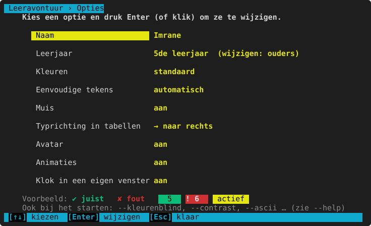
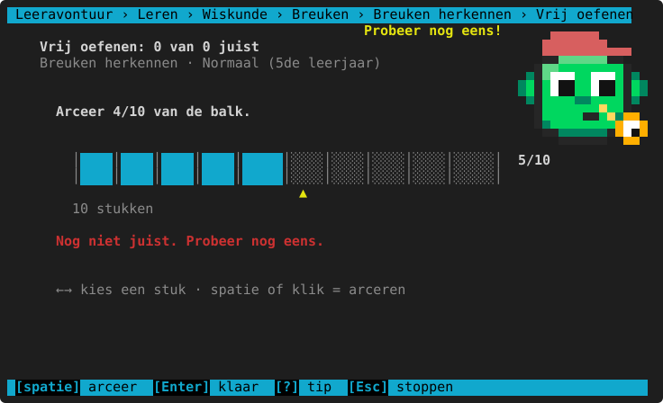
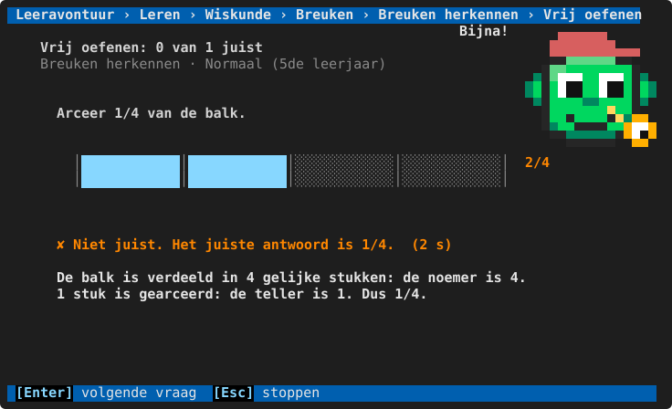
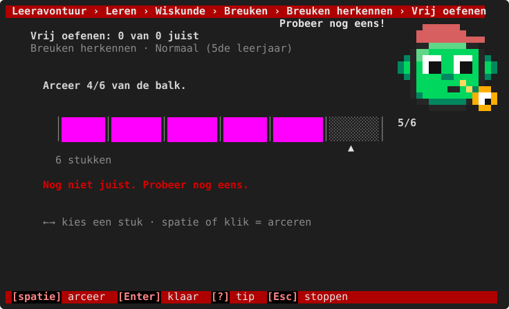
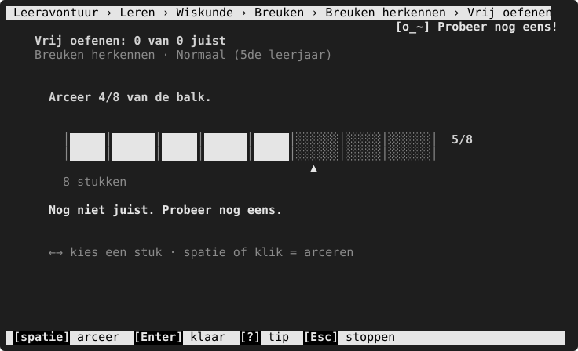
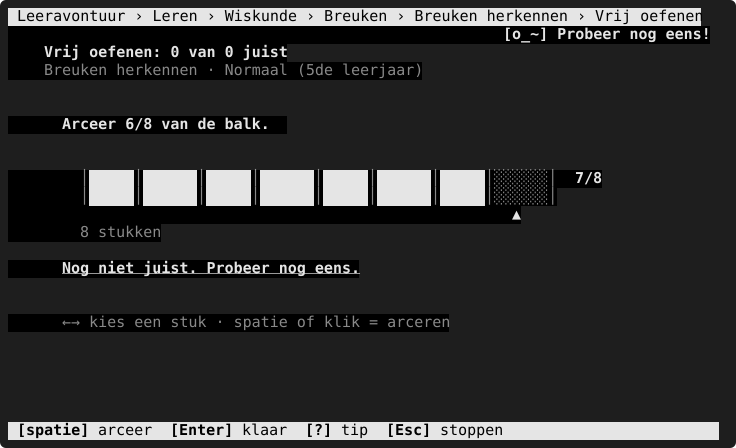
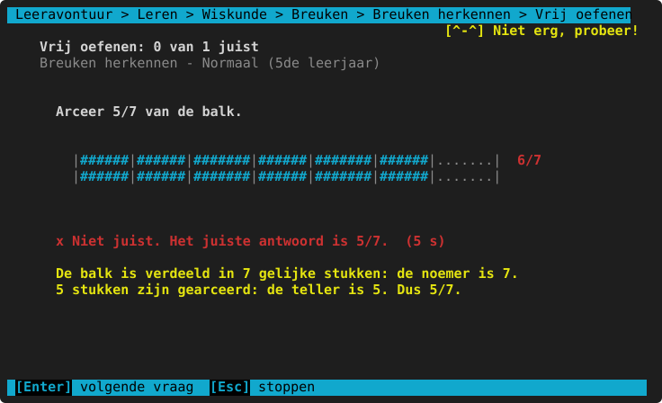

# Opties

**Waar:** hoofdmenu → **7. Opties** · [← terug naar de inhoud](README.md)

De instellingen van het kind dat nu oefent. Elk kind heeft zijn eigen opties; ze worden meteen bewaard.
Kies een optie met `↑` `↓` en druk Enter (of klik erop) om ze te wijzigen. `Esc` = klaar.

| Optie | Keuzes | Wat het doet |
|---|---|---|
| **Naam** | | De naam van het kind (zoals in "Hallo Imrane!"). |
| **Leerjaar** | | Alleen te bekijken: het leerjaar wijzigt de ouder in het [ouderdeel](ouderdeel.md). De [niveaus](README.md#niveaus-makkelijk-tot-heel-moeilijk) hangen ervan af. |
| **Kleuren** | standaard, kleurenblind (rood-groen), kleurenblind (blauw-geel), hoog contrast, geen kleur | Het kleurenthema. Juist en fout hebben altijd ook een teken (✔ ✘ !). Onderaan staat een voorbeeld. |
| **Eenvoudige tekens** | automatisch, aan (ASCII), uit | Voor oude terminals die lijnen en symbolen niet goed tonen: dan worden het gewone tekens (`+`, `-`, `#`). "Automatisch" kiest zelf. |
| **Muis** | aan, uit | Klikken en het scrollwiel. Uit = tekst selecteren en kopiëren werkt gewoon in de terminal. |
| **Typrichting in tabellen** | → naar rechts, ← naar links | In welke richting de cursor gaat in de eenhedentabel (ook met `r` tijdens de oefening). |
| **Avatar** | aan, uit | De pixel-avatar in het hoofdmenu en als oefenmaatje. Uit = een klein tekstgezichtje. |
| **Animaties** | aan, uit | De avatar springt even bij een juist antwoord. |
| **Klok in een eigen venster** | aan, uit | Bij [De klok](wiskunde/tijd-geld-snelheid.md#het-klokvenster) staat een echte wijzerklok in een apart venster. Uit (of als het niet kan) = de klok in de terminal. |

## De thema's naast elkaar

Zo ziet hetzelfde scherm eruit in elk thema (een fout antwoord op de breukbalk):

| Thema | Beeld |
|---|---|
| standaard |  |
| kleurenblind (rood-groen) |  |
| kleurenblind (blauw-geel) |  |
| hoog contrast |  |
| geen kleur |  |
| eenvoudige tekens (ASCII) |  |

Dezelfde keuzes bestaan ook als **startargument** voor één keer (bv. `--kleurenblind`); die worden niet bewaard.
Zie [Startargumenten](startargumenten.md).
