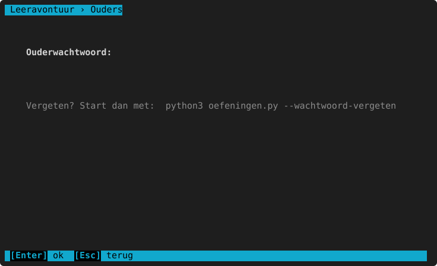
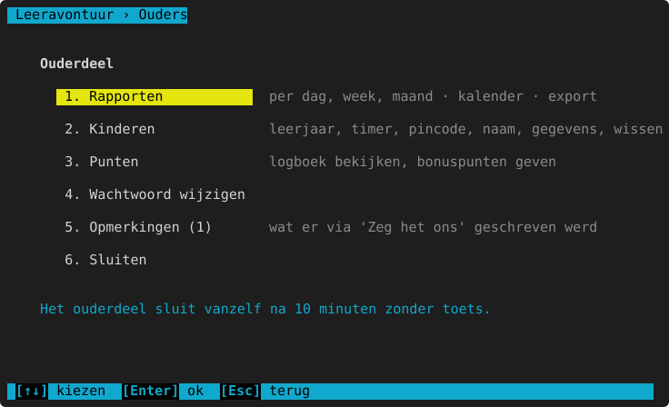
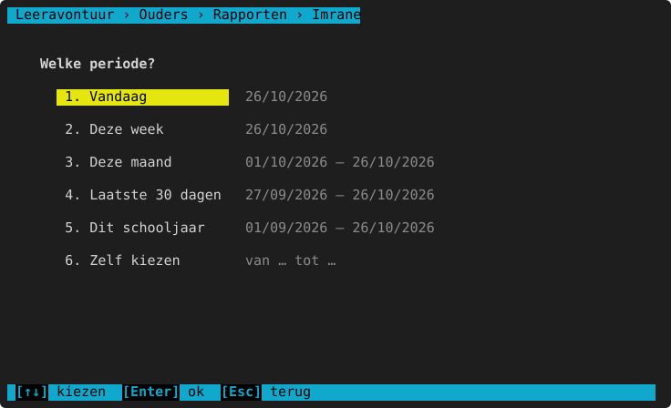
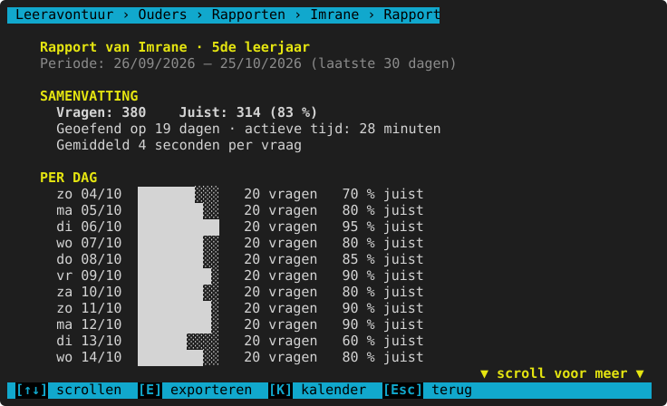
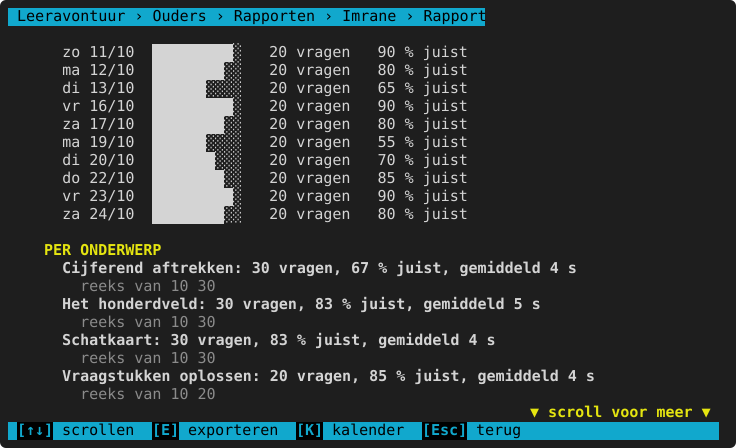
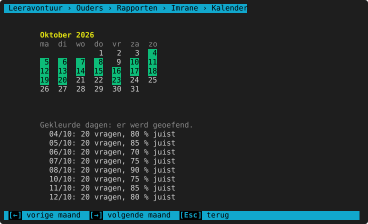
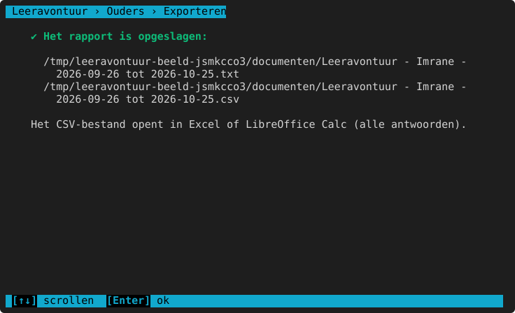
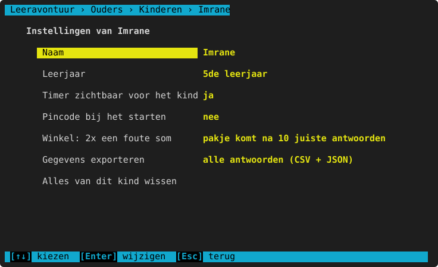
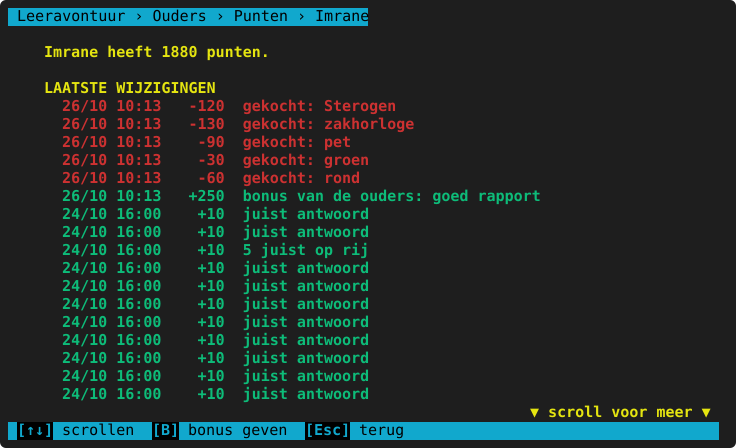
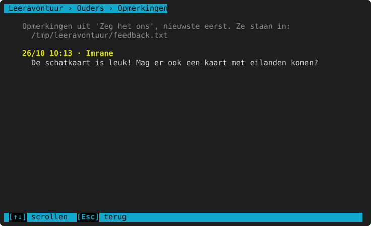

# Het ouderdeel

**Waar:** "Wie ben jij?" → **Ouders** (of start met `--ouder`) · [← terug naar de inhoud](README.md)

Hier volgt de ouder de vooruitgang op en stelt de kinderen in. Het ouderdeel is beveiligd met een
**ouderwachtwoord** en sluit vanzelf na **10 minuten zonder toets**.

## Het wachtwoord

De eerste keer kies je een wachtwoord (minstens 4 tekens, twee keer typen). Daarna vraagt het programma het telkens;
na 3 keer fout stopt het. Het wachtwoord wordt veilig bewaard (niet als gewone tekst).

Vergeten? Start het programma met `python3 leeravontuur.py --wachtwoord-vergeten` en typ `JA`: het wachtwoord wordt
gewist, de gegevens van de kinderen blijven bewaard. De volgende keer kies je een nieuw.

| Keuze | Wat het doet |
|---|---|
| **1. Rapporten** | De vooruitgang per kind en per periode, een kalender en exporteren. |
| **2. Kinderen** | Per kind: naam, leerjaar, timer, pincode, de winkelstraf, gegevens exporteren of wissen. |
| **3. Punten** | Het puntenlogboek en bonuspunten geven. |
| **4. Wachtwoord wijzigen** | Eerst het huidige, dan twee keer het nieuwe. |
| **5. Opmerkingen (n)** | Wat er via [Zeg het ons](zeg-het-ons.md) geschreven werd. |
| **6. Sluiten** | Terug naar "Wie ben jij?". |

Stonden er fouten in het foutenlogboek, dan meldt het ouderdeel dat onderaan (zie
[Problemen oplossen](problemen-oplossen.md#het-foutenlogboek)).

## Rapporten

Kies een kind en een periode:

Vandaag, deze week, deze maand, de laatste 30 dagen, dit schooljaar (vanaf 1 september), of **Zelf kiezen**: typ
een begin- en einddatum (`24/10/2026`, `24/10` of `2026-10-24`).

Het rapport (scrollen met `↑` `↓`):
- **Samenvatting**: hoeveel vragen, hoeveel juist, op hoeveel dagen, de actieve tijd en de tijd per vraag.
- **Per dag**: vragen en % juist, met een balkje.
- **Per onderwerp**: hoeveel vragen, % juist en de status (nog niet gezien, bezig, beheerst: minstens 10 vragen en
  80 % van de laatste 20 juist).
- **Meest gemaakte denkfouten**: welke typische fouten het vaakst voorkwamen (zie bij elk onderwerp in deel 1 wat ze
  betekenen).
- **Laatste fouten**: de vraag, wat het kind schreef en het juiste antwoord.

**Kalender** (`K`): per maand de dagen waarop geoefend werd, met hoeveel vragen en % juist. `←` `→` = vorige of
volgende maand.

**Exporteren** (`E`): het rapport als tekstbestand (`.txt`) en alle antwoorden van die periode als `.csv` (opent in
Excel of LibreOffice Calc). Ze komen in de map **Documenten/Leeravontuur** (of `Documents/Leeravontuur`).

## Kinderen

Kies een kind. Met `↑` `↓` en Enter wijzig je een instelling:

| Instelling | Wat het doet |
|---|---|
| **Naam** | De naam wijzigen (twee kinderen mogen niet dezelfde naam hebben). |
| **Leerjaar** | Het leerjaar van het kind (3de leerjaar … 2de middelbaar). Alle [niveaus](README.md#niveaus-makkelijk-tot-heel-moeilijk) schuiven mee. Doe dit bij het begin van een nieuw schooljaar. |
| **Timer zichtbaar voor het kind** | ja / nee. Nee: het kind ziet geen seconden en bij [Snelrekenen](snelrekenen.md) alleen "20 sommen" zonder klok. De tijd staat wel in het rapport. |
| **Pincode bij het starten** | Een pincode van 4 cijfers die het kind moet typen als het zijn naam kiest (zodat een broer of zus niet in zijn account oefent). Ook: een nieuwe pincode of de pincode weghalen. |
| **Winkel: 2x een foute som** | Wat er gebeurt als het kind bij het kopen 2 keer een foute som maakt: pakje na 10 juiste antwoorden, pakje na 15 minuten oefenen, 5 punten verzendkosten of geen straf. Zie [de winkel](avatar-en-winkel.md#kopen-eerst-even-rekenen). |
| **Gegevens exporteren** | Alle antwoorden ooit, als `.csv` en `.json` (in Documenten/Leeravontuur). |
| **Alles van dit kind wissen** | Het account, de instellingen en alle antwoorden. Typ ter controle de naam van het kind. Dit kan niet ongedaan gemaakt worden: exporteer eerst. |

Een nieuw kind maak je bij "Wie ben jij?" → **+ Nieuw kind**.

## Punten

Het **puntenlogboek**: elk punt dat het kind kreeg of uitgaf, met de datum en de reden (juist antwoord, 5 juist op
rij, record, gekocht …). Met `B` geef je **bonuspunten** (een aantal en een reden, bv. "goed rapport").

## Opmerkingen

Wat het kind of de ouder via [Zeg het ons](zeg-het-ons.md) schreef, de nieuwste eerst, met de naam en de datum.
Bovenaan staat in welk bestand ze bewaard zijn (`feedback.txt`), zodat je ze kunt doorsturen.

