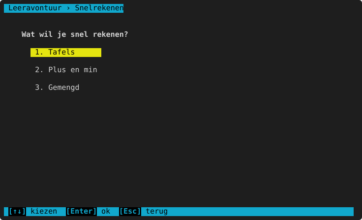
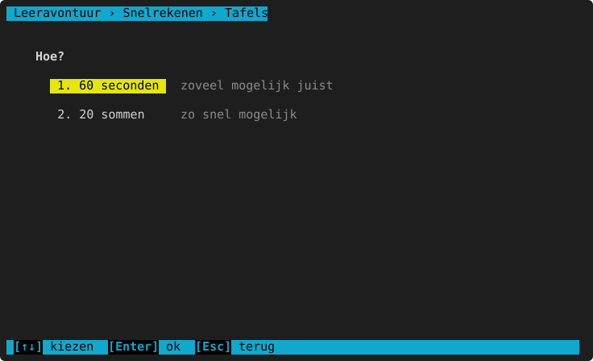
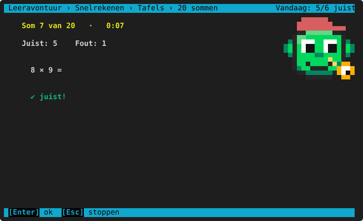
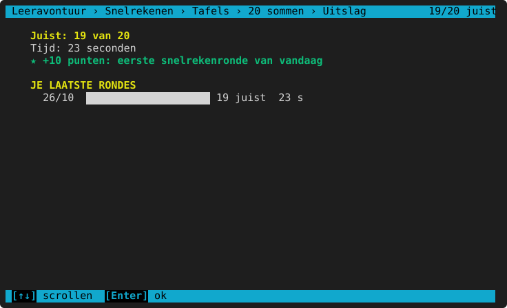

# Snelrekenen

**Waar:** hoofdmenu → **3. Snelrekenen** · [← terug naar de inhoud](README.md)

Tegen de klok rekenen, om de basis vlot te krijgen. De vragen komen uit [Hoofdrekenen](wiskunde/hoofdrekenen.md),
op het leerjaar van het kind.

**Wat?**
- **Tafels**: maal- en deeltafels.
- **Plus en min**: optellen en aftrekken uit het hoofd.
- **Gemengd**: tafels, plus en min, verdubbelen en halveren door elkaar.

**Hoe?**

- **60 seconden**: zoveel mogelijk juist in een minuut. Bovenaan loopt een balk mee met de seconden die je nog
  hebt (rood in de laatste 10 seconden).
- **20 sommen**: 20 sommen zo snel mogelijk. Bovenaan staat welke som je maakt en hoe lang je al bezig bent.

Heeft de ouder "Timer zichtbaar voor het kind" uitgezet ([ouderdeel](ouderdeel.md) → Kinderen), dan is er alleen
**20 sommen**, zonder klok. Zo kan een kind dat stress krijgt van een klok toch oefenen.

## Tijdens de ronde

Typ het antwoord en druk Enter: meteen komt de volgende som. Onder de som zie je of de vorige juist was
(✔ juist! of ✘ met het juiste antwoord), bovenaan hoeveel juist en fout je al had. Met `Esc` stop je.

## Het resultaat

Na de ronde: hoeveel juist, je tijd of je score, je bonuspunten en een overzicht van **je laatste rondes**, zodat
je ziet of je sneller wordt.

| Bonus | Punten |
|---|---|
| De eerste ronde van de dag met minstens 10 juist | +10 |
| Een nieuw record (per soort en per vorm) | +25 |

Gewone punten per som zijn er bij snelrekenen niet: de bonus beloont oefenen en beter worden, niet zo veel
mogelijk rondes spelen. In het [rapport](ouderdeel.md#rapporten) ziet de ouder de rondes ook.

> **Voor het kind:** Probeer je eigen record te breken. Twijfel je bij een tafel? Oefen die dan eens rustig bij
> Hoofdrekenen → Maal- en deeltafels: daar krijg je uitleg.
