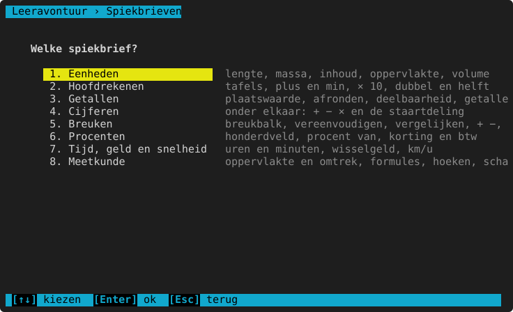

# Spiekbrieven

**Waar:** hoofdmenu → **6. Spiekbrieven** (of bij elk domein: Hoe wil je oefenen? → **Spiekbrief**) ·
[← terug naar de inhoud](README.md)

Per domein een blad met de regels, trucjes en voorbeelden om terug te lezen, zoals een spiekbriefje van school.
Scrollen met `↑` `↓` of het scrollwiel, terug met `Esc`.

| Spiekbrief | Wat erop staat | Bekijk |
|---|---|---|
| Eenheden | hoe omzetten werkt, alle tabellen (ook oppervlakte en volume), voorbeelden | [Eenheden](wiskunde/eenheden.md#spiekbrief) |
| Hoofdrekenen | compenseren, splitsen, tafeltrucs, × en : met 10, verdubbelen | [Hoofdrekenen](wiskunde/hoofdrekenen.md#spiekbrief) |
| Getallen | plaatswaarde, afronden, kenmerken van deelbaarheid, de getallenlijn | [Getallen](wiskunde/getallen.md#spiekbrief) |
| Cijferen | onder elkaar optellen, aftrekken, vermenigvuldigen, de staartdeling | [Cijferen](wiskunde/cijferen.md#spiekbrief) |
| Breuken | teller en noemer, gelijknamig maken, vereenvoudigen, breuk van | [Breuken](wiskunde/breuken.md#spiekbrief) |
| Procenten | procent = per honderd, handige procenten, korting en btw | [Procenten](wiskunde/procenten.md#spiekbrief) |
| Tijd, geld en snelheid | 60 minuten in een uur, wisselgeld, afstand = snelheid × tijd | [Tijd, geld en snelheid](wiskunde/tijd-geld-snelheid.md#spiekbrief) |
| Meetkunde | formules, soorten hoeken, coördinaten, schaal | [Meetkunde](wiskunde/meetkunde.md#spiekbrief) |
| Vraagstukken | de 4 stappen, sleutelwoorden, het klad, kan dat kloppen? | [Vraagstukken](wiskunde/vraagstukken.md#spiekbrief) |

De volledige tekst van elke spiekbrief staat onderaan de pagina van het domein.

> **Voor het kind:** Weet je het even niet meer? Kijk op de spiekbrief. Daarna lukt het vast!
