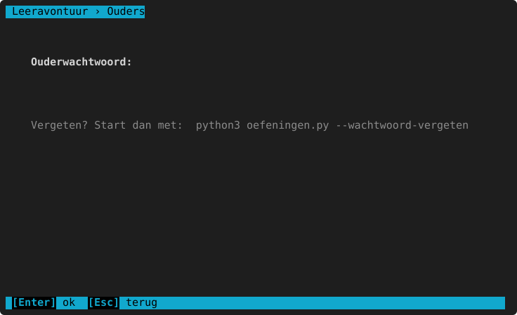

# Startargumenten

[← terug naar de inhoud](README.md)

Je start het programma met `python3 leeravontuur.py` (op Windows `python leeravontuur.py`). Achter de opdracht kun je
een of meer **argumenten** zetten, bv.:

```text
python3 leeravontuur.py --kleurenblind
python3 leeravontuur.py --kleurenblind blauw-geel --geen-muis
python3 leeravontuur.py --ouder
python3 leeravontuur.py --help
```

`--help` toont deze lijst ook in de terminal.

## Alle argumenten

<!-- auto:argumenten -->
| Argument | Wat het doet |
|---|---|
| `--kleurenblind [rood-groen of blauw-geel]` | kleuren voor kleurenblindheid (standaard: rood-groen) |
| `--contrast` | hoog contrast (zwart-wit) |
| `--geen-kleur` | geen kleuren gebruiken |
| `--ascii` | alleen eenvoudige tekens (voor oude terminals) |
| `--geen-muis` | muis uitzetten (tekst selecteren werkt dan gewoon) |
| `--zonder-klokvenster` | de wijzerklok in de terminal tekenen, niet in een eigen venster |
| `--ouder` | meteen naar het ouderdeel (rapporten, kinderen) |
| `--wachtwoord-vergeten` | het ouderwachtwoord wissen (de gegevens van de kinderen blijven bewaard) |
| `--snelkoppeling` | menu-snelkoppeling maken (Linux) |
| `--fouten` | de laatste fouten uit het foutenlogboek tonen |
| `--debug` | bij een fout meteen stoppen met de volledige melding |
| `--test` | de automatische tests uitvoeren |
| `--versie` | versie tonen |
<!-- /auto -->

## Weergave: voor één keer

`--kleurenblind`, `--contrast`, `--geen-kleur`, `--ascii`, `--geen-muis` en `--zonder-klokvenster` gelden **alleen voor die keer** en worden
niet bewaard. Wil je het altijd zo, kies het dan bij [Opties](opties.md) (per kind). Zo kan een ouder bv. even in
hoog contrast kijken zonder de instellingen van het kind te veranderen. Hoe elk thema eruitziet:
[Opties → De thema's naast elkaar](opties.md#de-themas-naast-elkaar).

- `--kleurenblind` zonder meer = rood-groen; `--kleurenblind blauw-geel` voor blauw-geel.
- `--ascii` is voor oude terminals (bv. een oud Windows-venster) die lijnen of symbolen als vreemde tekens tonen.
- `--geen-muis`: als klikken problemen geeft, of als je tekst wil selecteren en kopiëren.
- `--zonder-klokvenster`: de wijzerklok gewoon in de terminal, zonder het [klokvenster](wiskunde/tijd-geld-snelheid.md#het-klokvenster)
  (bv. via ssh, of als het venster op jouw computer niet goed werkt).


## Opdrachten die meteen stoppen

Deze doen één ding in de terminal en starten het programma niet:

| Argument | Wat je ziet |
|---|---|
| `--versie` | bv. `Leeravontuur 0.15.0 · een gratis leerprogramma van Solve It Now · CC BY-NC-SA 4.0` |
| `--test` | Alle automatische tests lopen (een paar honderd); op het einde `OK` of wat er misliep. |
| `--fouten` | De laatste 3 meldingen uit het foutenlogboek, en waar het bestand staat. Zie [Problemen oplossen](problemen-oplossen.md#het-foutenlogboek). |
| `--wachtwoord-vergeten` | Vraagt `JA` en wist dan het ouderwachtwoord (de gegevens blijven). |
| `--snelkoppeling` | Linux: maakt "Leeravontuur" in het startmenu (bij Onderwijs/Education). |

`--ouder` start wel het programma, maar gaat meteen naar het wachtwoord van het [ouderdeel](ouderdeel.md):



`--debug` zet het vangnet uit: bij een fout stopt het programma met de volledige foutmelding in plaats van "Oei, er
ging iets mis". Alleen nodig om een fout te zoeken.

## Omgevingsvariabelen (voor gevorderden)

| Variabele | Wat het doet |
|---|---|
| `LEERAVONTUUR_DATA` | Een andere map voor de gegevens (de databank, reservekopieën, het foutenlogboek, `feedback.txt`). Bv. om op een USB-stick te werken of om iets uit te proberen zonder de echte gegevens. |
| `LEERAVONTUUR_DOCUMENTEN` | Een andere map voor geëxporteerde rapporten. |
| `LEERAVONTUUR_DEBUG=1` | Hetzelfde als `--debug`. |
| `LEERAVONTUUR_ZAAD` | Altijd dezelfde vragen (gebruikt voor de schermafdrukken van deze handleiding). |
| `LEERAVONTUUR_AAP`, `LEERAVONTUUR_AAP_SEEDS`, `LEERAVONTUUR_AAP_RONDES` | Voor de automatische "aapjestest": hoe lang die willekeurig op toetsen drukt. |

Voorbeeld (Linux/macOS): `LEERAVONTUUR_DATA=~/proef python3 leeravontuur.py`. Op Windows (PowerShell):
`$env:LEERAVONTUUR_DATA="C:\proef"; python leeravontuur.py`.
