# Breuken

**Waar:** Leren & oefenen → Wiskunde → **Breuken** · [← terug naar de inhoud](../README.md)

Breuken met de **breukbalk**: een balk in gelijke stukken (de noemer), waarvan je er een aantal arceert (de
teller). Verder: gelijkwaardige breuken en vereenvoudigen, vergelijken, optellen en aftrekken, een breuk van een
getal, × en : met breuken, en breuk ↔ kommagetal.

**Een breuk typen:** met een schuine streep, `3/4`. Een gemengd getal met een spatie: `1 3/4`. Het programma
kijkt naar de waarde (`2/4` is juist als `1/2` gevraagd is), behalve als de vraag de **eenvoudigste vorm** vraagt.

## De breukbalk

Bij "Arceer …" en "Toon … met … stukken" werk je op de breukbalk:

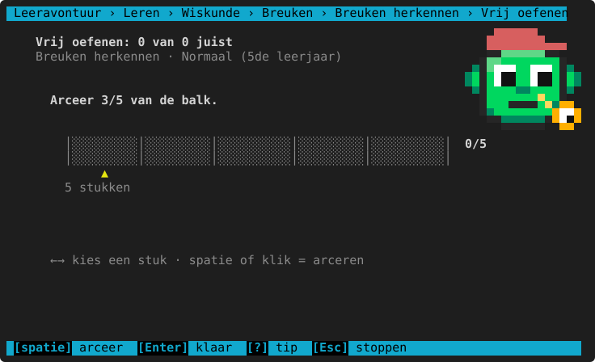

| Toets of muis | Wat het doet |
|---|---|
| `←` `→` | Een stuk kiezen (het pijltje ▲ eronder). |
| Spatie of klik op een stuk | Dat stuk arceren (of weer wit maken). |
| `↑` `↓` | De **noemer** veranderen: in hoeveel stukken de balk verdeeld is (1 tot 20), als de vraag dat toelaat. |
| `v` | **Vereenvoudigen**: stukken samenvoegen (bv. 4/8 → 2/4), als het kan. |
| `Enter` | Klaar: nakijken. |

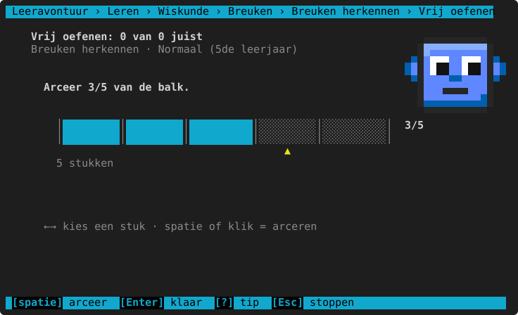

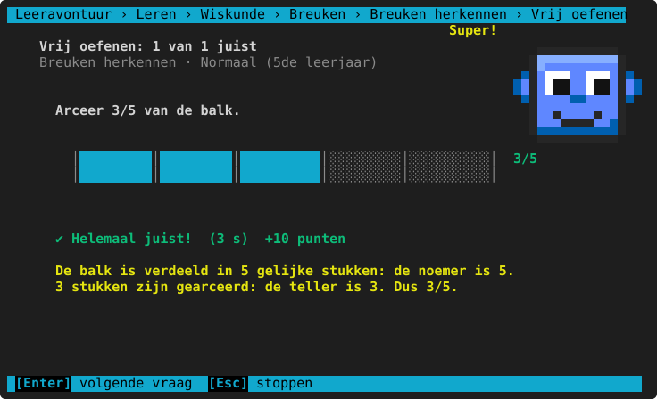

## Breuken herkennen

Welke breuk is gearceerd (typ de breuk), en zelf een breuk arceren op de balk.

**Per leerjaar**

<!-- auto:leerlijn wiskunde.breuken.herkennen -->
|  | 3de leerjaar | 4de leerjaar | 5de leerjaar | 6de leerjaar |
|---|---|---|---|---|
| **soorten vragen** | aflezen, arceren | idem | idem | idem |
| **noemers** | 2, 3, 4, 5, 6, 8, 10 | + 12 | 3, 4, 5, 6, 7, 8, 9, 10, 12, 15, 16 | 5, 6, 7, 8, 9, 10, 12, 15, 16, 18, 20 |
<!-- /auto -->

**Herkende denkfouten**

<!-- auto:denkfouten wiskunde.breuken.herkennen -->
- teller en noemer omgewisseld
- de stukken die niet gearceerd zijn geteld
- gearceerd tegen niet-gearceerd vergeleken (in plaats van tegen het geheel)
<!-- /auto -->

## Gelijkwaardig en vereenvoudigen

`2/3 = ?/12` aanvullen, een breuk tonen met meer stukken op de balk, en vereenvoudigen "zo ver mogelijk". Na een
fout tonen twee balken onder elkaar dat de breuken even groot zijn.

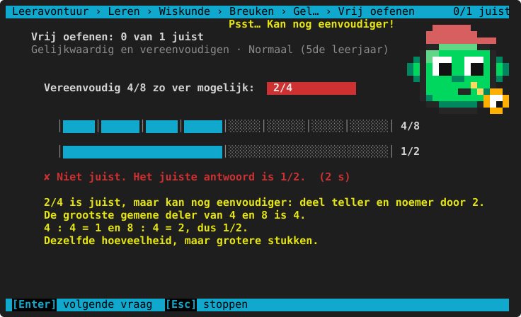

**Per leerjaar**

<!-- auto:leerlijn wiskunde.breuken.gelijkwaardig -->
|  | 3de leerjaar | 4de leerjaar | 5de leerjaar | 6de leerjaar | 1ste middelbaar |
|---|---|---|---|---|---|
| **soorten vragen** | — | aanvullen (3/4 = ?/8) | + vereenvoudigen, op de breukbalk | idem | aanvullen (3/4 = ?/8), vereenvoudigen |
| **noemers tot** | — | 10 | 12 | 24 | 60 |
| **vermenigvuldigen met hoogstens** | — | 3 | 4 | 6 | 12 |

— = komt nog niet aan bod in het 3de leerjaar: dat niveau kun je dan niet kiezen (er staat "nog niet in dit leerjaar").
<!-- /auto -->

**Herkende denkfouten**

<!-- auto:denkfouten wiskunde.breuken.gelijkwaardig -->
- niet volledig vereenvoudigd
- alleen de teller (of alleen de noemer) veranderd
- bij teller en noemer iets opgeteld in plaats van vermenigvuldigd
<!-- /auto -->

## Breuken vergelijken

Groter, kleiner of gelijk? Typ `<`, `>` of `=`. Na het nakijken staan de balken onder elkaar, zodat je ziet welke
breuk het grootst is.

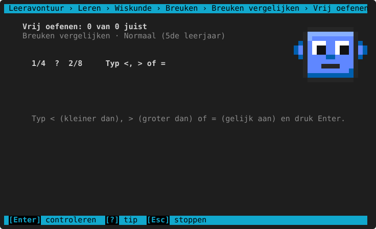

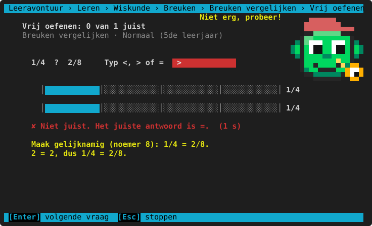

**Per leerjaar**

<!-- auto:leerlijn wiskunde.breuken.vergelijken -->
|  | 3de leerjaar | 4de leerjaar | 5de leerjaar | 6de leerjaar | 1ste middelbaar |
|---|---|---|---|---|---|
| **soorten vragen** | — | gelijknamig, gelijke teller | + ongelijknamig | gelijke teller, ongelijknamig | ongelijknamig |
| **noemers tot** | — | 10 | 12 | 15 | 20 |

— = komt nog niet aan bod in het 3de leerjaar: dat niveau kun je dan niet kiezen (er staat "nog niet in dit leerjaar").
<!-- /auto -->

**Herkende denkfouten**

<!-- auto:denkfouten wiskunde.breuken.vergelijken -->
- gedacht dat een grotere noemer een grotere breuk geeft
- alleen de tellers vergeleken bij verschillende noemers
<!-- /auto -->

## Optellen en aftrekken

Gelijknamige breuken, ongelijknamige (eerst gelijknamig maken, later met het kgv), gemengde getallen en in het 1ste
middelbaar een negatieve uitkomst. Is "uitkomst vereenvoudigen" aan, dan moet het antwoord zo eenvoudig mogelijk.

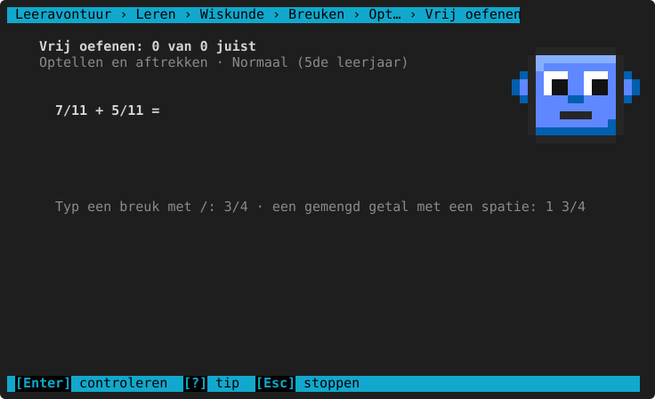

De klassieke fout "tellers én noemers opgeteld" wordt herkend en uitgelegd:

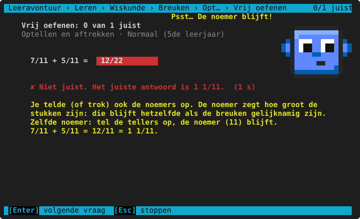

**Per leerjaar**

<!-- auto:leerlijn wiskunde.breuken.optellen -->
|  | 3de leerjaar | 4de leerjaar | 5de leerjaar | 6de leerjaar | 1ste middelbaar |
|---|---|---|---|---|---|
| **soorten vragen** | — | gelijknamig | + ongelijknamig | + gemengde getallen | ongelijknamig, gemengde getallen, met negatieve uitkomst |
| **noemers tot** | — | 10 | 12 | idem | 15 |
| **gelijknamig maken met het kgv** | — | nee | idem | ja | idem |
| **uitkomst vereenvoudigen** | — | nee | ja | idem | idem |

— = komt nog niet aan bod in het 3de leerjaar: dat niveau kun je dan niet kiezen (er staat "nog niet in dit leerjaar").
<!-- /auto -->

**Herkende denkfouten**

<!-- auto:denkfouten wiskunde.breuken.optellen -->
- tellers én noemers opgeteld (1/2 + 1/3 = 2/5)
- niet gelijknamig gemaakt (tellers opgeteld, één noemer gehouden)
<!-- /auto -->

## Breuk van een getal

`2/3 van 12`: de bolletjes worden in groepjes verdeeld (de noemer), en de juiste groepjes kleuren mee in de uitleg.
Vanaf het 6de ook breuk × getal, breuk : getal en (1ste middelbaar) breuk × en : breuk.

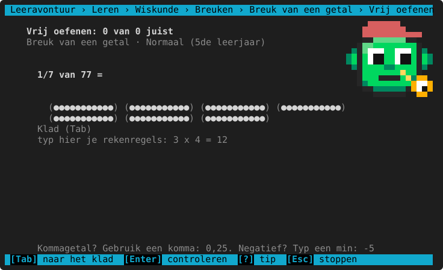

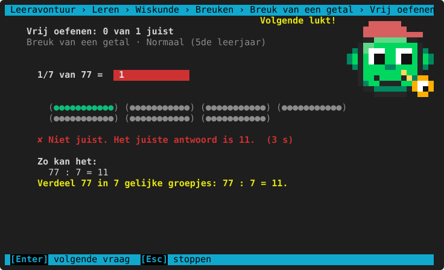

**Per leerjaar**

<!-- auto:leerlijn wiskunde.breuken.van -->
|  | 3de leerjaar | 4de leerjaar | 5de leerjaar | 6de leerjaar | 1ste middelbaar |
|---|---|---|---|---|---|
| **soorten vragen** | — | breuk van een getal | + breuk × getal | + breuk × breuk, breuk : getal | breuk × breuk, breuk : getal, breuk : breuk |
| **noemers tot** | — | 10 | idem | 12 | idem |
| **alleen stambreuken (1/n)** | — | ja | nee | idem | idem |
| **getallen tot** | — | 50 | 100 | 200 | idem |

— = komt nog niet aan bod in het 3de leerjaar: dat niveau kun je dan niet kiezen (er staat "nog niet in dit leerjaar").
<!-- /auto -->

**Herkende denkfouten**

<!-- auto:denkfouten wiskunde.breuken.van -->
- alleen door de noemer gedeeld (de teller vergeten)
- door de teller gedeeld en met de noemer vermenigvuldigd
- bij een breuk × getal ook de noemer vermenigvuldigd
- bij delen door een breuk niet met het omgekeerde vermenigvuldigd
<!-- /auto -->

## Breuk en kommagetal

`3/4 = 0,75` en `0,6 = 3/5`. De uitleg maakt een noemer 10, 100 of 1000.

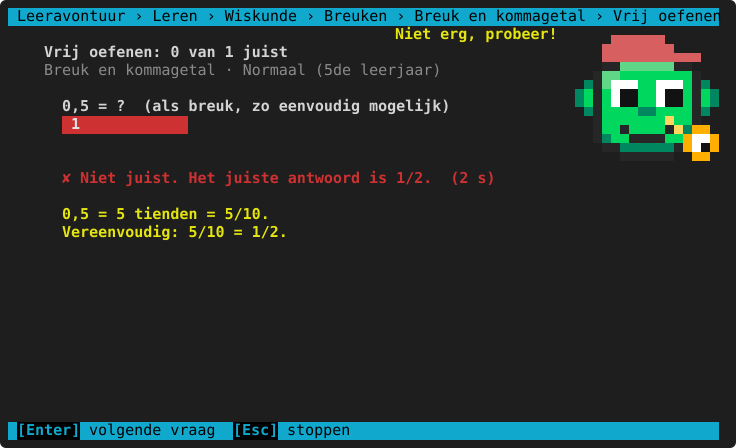

**Per leerjaar**

<!-- auto:leerlijn wiskunde.breuken.kommagetal -->
|  | 3de leerjaar | 4de leerjaar | 5de leerjaar | 6de leerjaar |
|---|---|---|---|---|
| **soorten vragen** | — | breuk → kommagetal | + kommagetal → breuk | idem |
| **noemers** | — | 2, 10 | + 4, 5, 100 | + 8, 20, 25, 50 |

— = komt nog niet aan bod in het 3de leerjaar: dat niveau kun je dan niet kiezen (er staat "nog niet in dit leerjaar").
<!-- /auto -->

**Herkende denkfouten**

<!-- auto:denkfouten wiskunde.breuken.kommagetal -->
- de breuk gelezen als kommagetal (3/4 = 3,4)
- tienden en honderdsten verwisseld
<!-- /auto -->

## Spiekbrief

<!-- auto:spiekbrief wiskunde.breuken.herkennen -->
```text
DE BREUKBALK
  3/4: de noemer (4) zegt in hoeveel gelijke stukken je verdeelt,
  de teller (3) hoeveel stukken je neemt.   ███│███│███│░░░

GELIJKWAARDIG EN VEREENVOUDIGEN
  Teller en noemer × of : hetzelfde getal: 1/2 = 2/4 = 4/8.
  Vereenvoudigen: deel door de grootste gemene deler. 18/24 → : 6 → 3/4.

VERGELIJKEN EN OPTELLEN
  Zelfde noemer? Vergelijk/tel de tellers. De noemer blijft!
  Andere noemers? Eerst gelijknamig maken: 1/2 + 1/3 = 3/6 + 2/6 = 5/6.
  Zelfde teller? Hoe groter de noemer, hoe kleiner de stukken: 1/3 > 1/5.

BREUK VAN EEN GETAL
  2/3 van 12: eerst : 3 (= 4), dan × 2 → 8.
  Breuk × breuk: teller × teller en noemer × noemer.
  Delen door een breuk: vermenigvuldigen met het omgekeerde.

BREUK EN KOMMAGETAL
  1/2 = 0,5   1/4 = 0,25   3/4 = 0,75   1/5 = 0,2   1/10 = 0,1   1/100 = 0,01
```
<!-- /auto -->

> **Voor het kind:** De noemer (onder de streep) zegt in hoeveel stukken het geheel verdeeld is, de teller
> (boven) hoeveel stukken je neemt. Zelfde noemer bij optellen? Tel de tellers, de noemer blijft!
