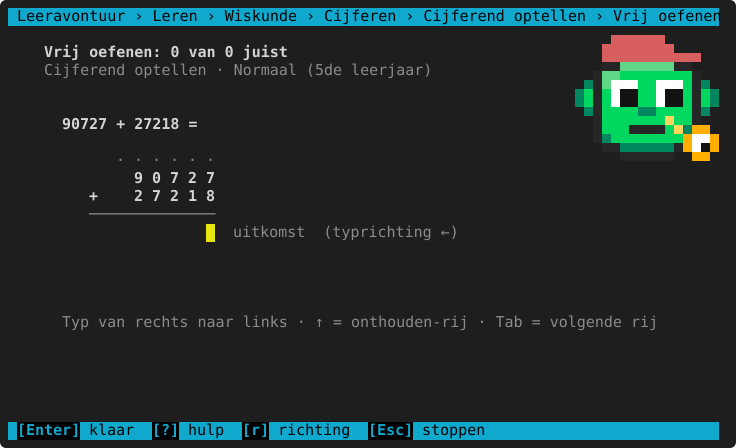
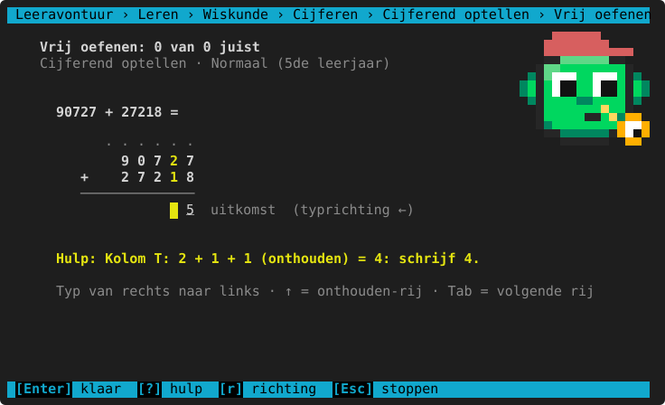
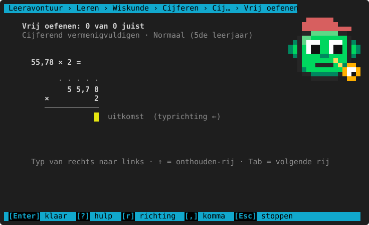
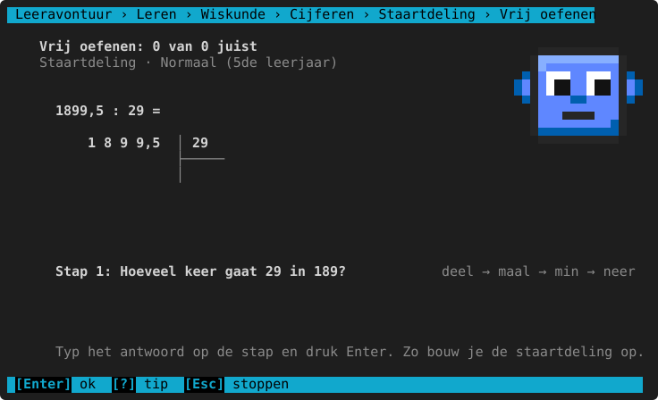
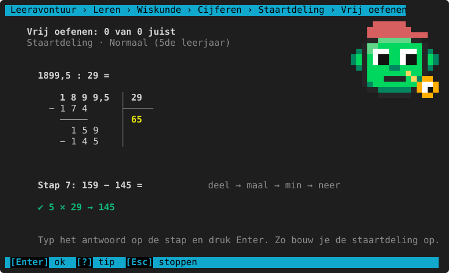

# Cijferen

**Waar:** Leren & oefenen → Wiskunde → **Cijferen** · [← terug naar de inhoud](../README.md)

Rekenen **onder elkaar**, zoals op papier: in een rooster met één cijfer per vakje. Optellen (met onthouden),
aftrekken (met lenen), vermenigvuldigen (ook met 2 cijfers en kommagetallen) en de **staartdeling** stap voor stap.

## Optellen, aftrekken en vermenigvuldigen in het rooster



Bovenaan staat de **onthouden-rij** (de puntjes), dan de getallen en onder de streep de uitkomst. Het kind begint
rechts en typt van rechts naar links.

| Toets of muis | Wat het doet |
|---|---|
| Een cijfer | In het vakje; de cursor gaat een vakje verder (standaard naar links). |
| `←` `→` | Een vakje opzij. |
| `↑` `↓` | Naar een andere rij, bv. de **onthouden-rij** bovenaan. |
| Klik op een vakje | Daarheen gaan. |
| `Tab` | Naar de volgende rij om in te vullen (bij vermenigvuldigen met 2 cijfers: de tussenrijen). |
| `r` | Typrichting omdraaien (← van rechts naar links of → van links naar rechts). |
| `,` | Bij vermenigvuldigen met kommagetallen: de komma in de uitkomst zetten. Bij + en − staat de komma al vast. |
| Backspace, spatie, Delete | Een cijfer wissen. |
| `?` | **Hulp bij het vakje** waar je staat, bv. "Kolom T: 2 + 1 + 1 (onthouden) = 4: schrijf 4". De cijfers van die kolom lichten op. |
| `Enter` | Klaar: nakijken. |



Bij vermenigvuldigen met 2 cijfers zijn er tussenrijen (eerst × de eenheden, dan × de tientallen, een plaats
opgeschoven) en dan de som:



Na het nakijken kijkt het programma naar **alle rijen** (ook de onthouden-rij en de tussenrijen) om de denkfout te
vinden, bv. "onthouden vergeten" of "de tweede rij niet opgeschoven".

### Cijferend optellen

<!-- auto:leerlijn wiskunde.cijferen.optellen -->
|  | 3de leerjaar | 4de leerjaar | 5de leerjaar | 6de leerjaar | 1ste middelbaar |
|---|---|---|---|---|---|
| **hoogstens cijfers** | 3 | 5 | 6 | 7 | idem |
| **hoogstens cijfers na de komma** | 0 | 2 | 3 | idem | idem |
| **hoogstens getallen onder elkaar** | 2 | idem | 3 | idem | idem |
<!-- /auto -->

**Herkende denkfouten**

<!-- auto:denkfouten wiskunde.cijferen.optellen -->
- onthouden vergeten bij het optellen
<!-- /auto -->

### Cijferend aftrekken

<!-- auto:leerlijn wiskunde.cijferen.aftrekken -->
|  | 3de leerjaar | 4de leerjaar | 5de leerjaar | 6de leerjaar | 1ste middelbaar |
|---|---|---|---|---|---|
| **hoogstens cijfers** | 3 | 5 | 6 | 7 | idem |
| **hoogstens cijfers na de komma** | 0 | 2 | 3 | idem | idem |
<!-- /auto -->

**Herkende denkfouten**

<!-- auto:denkfouten wiskunde.cijferen.aftrekken -->
- per kolom de kleinste van de grootste afgetrokken
- geleend, maar de kolom links niet 1 kleiner gemaakt
<!-- /auto -->

### Cijferend vermenigvuldigen

<!-- auto:leerlijn wiskunde.cijferen.vermenigvuldigen -->
|  | 3de leerjaar | 4de leerjaar | 5de leerjaar | 6de leerjaar | 1ste middelbaar |
|---|---|---|---|---|---|
| **cijfers van het eerste getal** | 2 | 3 | 4 | idem | idem |
| **cijfers van het tweede getal** | 1 | 2 | idem | idem | idem |
| **hoogstens cijfers na de komma** | 0 | idem | 2 | 3 | idem |
<!-- /auto -->

**Herkende denkfouten**

<!-- auto:denkfouten wiskunde.cijferen.vermenigvuldigen -->
- de tweede rij niet opgeschoven (de 0 vergeten)
- de komma op de verkeerde plaats in het product
<!-- /auto -->

## De staartdeling

De staartdeling groeit **stap voor stap** mee. Onderaan staat telkens één vraag:

1. **Deel**: hoeveel keer gaat de deler in het getal?
2. **Maal**: dat getal × de deler.
3. **Min**: trek af.
4. **Neer**: haal het volgende cijfer neer.



Typ het antwoord op de stap en druk Enter. Juist → de staartdeling groeit verder. Fout → een uitleg en nog een
kans; na 2 keer fout geeft het programma het antwoord (met uitleg) en ga je verder. Met `?` krijg je een tip voor
de stap. Vanaf het 5de komt er soms een komma in het quotiënt, en een deling met een rest.



**Per leerjaar**

<!-- auto:leerlijn wiskunde.cijferen.delen -->
|  | 3de leerjaar | 4de leerjaar | 5de leerjaar | 6de leerjaar | 1ste middelbaar |
|---|---|---|---|---|---|
| **hoogstens cijfers** | — | 3 | 4 | idem | idem |
| **cijfers van de deler** | — | 1 | 2 | idem | idem |
| **hoogstens cijfers na de komma** | — | 0 | 1 | 2 | idem |
| **ook met een rest** | — | ja | idem | idem | nee |

— = komt nog niet aan bod in het 3de leerjaar: dat niveau kun je dan niet kiezen (er staat "nog niet in dit leerjaar").
<!-- /auto -->

**Herkende denkfouten**

<!-- auto:denkfouten wiskunde.cijferen.delen -->
- bij de staartdeling te veel keer geschat
- bij de staartdeling te weinig keer geschat (rest te groot)
- een maalfout in de staartdeling
- een aftrekfout in de staartdeling
- verkeerd neergehaald in de staartdeling
<!-- /auto -->

## Spiekbrief

<!-- auto:spiekbrief wiskunde.cijferen.optellen -->
```text
CIJFEREN ONDER ELKAAR
  Zet eenheden onder eenheden, komma onder komma.
  Begin rechts, bij de kleinste plaats, en werk naar links.

OPTELLEN
  Is een kolom samen 10 of meer? Schrijf de eenheden, onthoud de tientallen.
  7 + 5 = 12: schrijf 2, onthoud 1 (bovenaan in de kolom links).

AFTREKKEN
  Is het bovenste cijfer te klein? Leen 1 bij de kolom links (die wordt 1 kleiner).
  Nooit 'de kleinste van de grootste': 2 − 7 kan niet, dus 12 − 7 = 5.

VERMENIGVULDIGEN
  Elk cijfer van het onderste getal geeft een rij. Rij 2 begint met een 0.
  Tel de rijen op. Komma? Tel alle cijfers na de komma samen.

STAARTDELING
  Deel → vermenigvuldig → trek af → haal neer. En opnieuw.
  De rest moet altijd kleiner zijn dan de deler.
  Controle: quotiënt × deler + rest = deeltal.
```
<!-- /auto -->

> **Voor het kind:** Begin altijd rechts. Is het meer dan 9? Schrijf de eenheden en zet 1 in de onthouden-rij
> (met `↑`). Bij de staartdeling: deel → maal → min → neer, en opnieuw.
