# Eenheden

**Waar:** Leren & oefenen → Wiskunde → **Eenheden** · [← terug naar de inhoud](../README.md)

Het kind zet maten om van de ene eenheid naar de andere: lengte (km … mm), massa (t … mg), inhoud (hl … ml),
oppervlakte (km² … mm², met ha, a en ca) en volume (m³, dm³, cm³, samen met de liters). Het werkt zoals op school
met de **eenhedentabel**: elke kolom naar rechts is 10 keer kleiner.

Eenheden heeft een eigen menu met vier vormen:

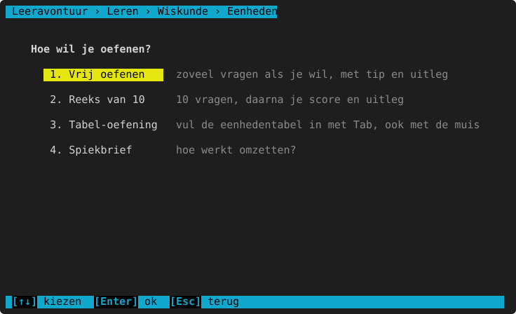

| Vorm | Wat het is |
|---|---|
| **Vrij oefenen** | Zoveel omzettingen als je wil, met uitleg na elk antwoord. |
| **Reeks van 10** | 10 omzettingen, daarna je score en uitleg bij je fouten (met `F` en `G`, zoals bij [een reeks](../README.md#een-reeks-van-10-en-fouten-opnieuw)). |
| **Tabel-oefening** | 10 omzettingen waarbij je de eenhedentabel zelf invult: cijfer per vakje, de komma, en dan het antwoord. |
| **Spiekbrief** | Hoe omzetten werkt, alle tabellen en voorbeelden. |

## Welke eenheden?

Na de vorm kies je de soort eenheden, daarna het [niveau](../README.md#niveaus-makkelijk-tot-heel-moeilijk).

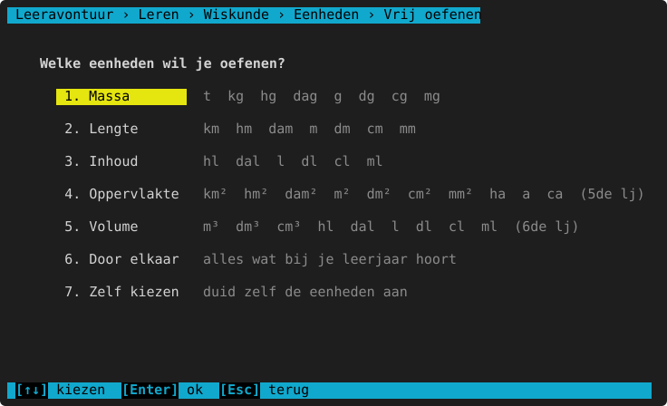

- **Massa, Lengte, Inhoud**: vanaf het 3de leerjaar.
- **Oppervlakte** (km² … mm², ha, a, ca): vanaf het 5de leerjaar. Elke eenheid heeft **2 vakjes** in de tabel.
- **Volume** (m³, dm³, cm³ en hl … ml): vanaf het 6de leerjaar. Elke eenheid heeft **3 vakjes**; 1 dm³ = 1 l en
  1 cm³ = 1 ml.
- **Door elkaar**: alle soorten die bij het gekozen leerjaar horen.
- **Zelf kiezen**: duid zelf de eenheden aan. Met `↑` `↓` (of de pijltjes) ga je naar een eenheid, met **spatie**
  (of een klik) zet je ze aan of uit, met `Enter` begin je. Je hebt minstens 2 eenheden van dezelfde soort nodig.

  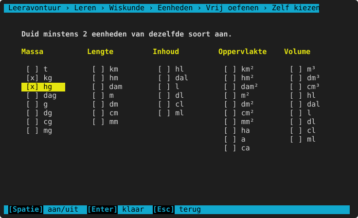

## Vrij oefenen en reeks

De vraag staat links, het antwoordvak erachter met de eenheid. Typ het getal en druk Enter.

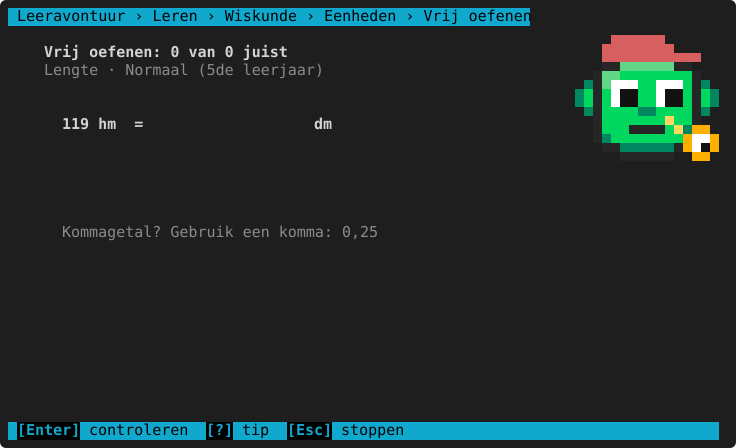

Na een fout zie je het juiste antwoord, de **denkfout** (als het programma ze herkent), de regel en de berekening.
Hier schoof de komma één plaats te ver:

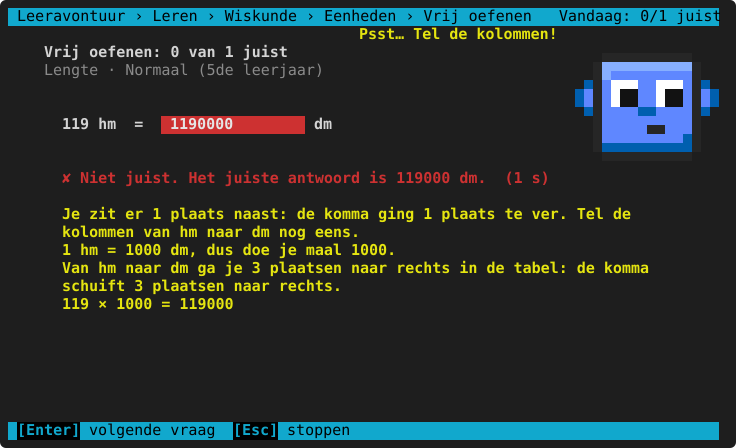

## De tabel-oefening

Het kind vult de eenhedentabel zelf in, zoals op papier. Boven de tabel staat wat er moet gebeuren
("Komma achter dam · nullen aanvullen tot cm · zet met , de komma achter cm") en in welke richting je typt.

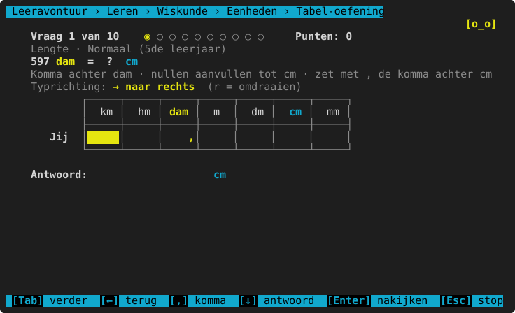

**Zo vul je de tabel in:**

| Toets of muis | Wat het doet |
|---|---|
| Een cijfer | Zet het cijfer in het vakje; de cursor gaat een vakje verder (in de typrichting). |
| `Tab` of `→` | Een vakje verder (na het laatste vakje: het antwoordvak). |
| `←` (of Shift+Tab) | Een vakje terug. |
| Klik op een vakje | Ga naar dat vakje. |
| `,` (of `.`) | Zet de komma achter het cijfer dat je net typte, of achter het vakje waar je staat. Nog eens = weg. |
| Klik op de rand tussen twee vakjes | Zet daar de komma. |
| `r` | Typrichting omdraaien: → naar rechts of ← naar links (wordt onthouden, ook bij [Opties](../opties.md)). |
| Backspace, Delete of spatie | Een cijfer wissen. |
| `↓` | Naar het antwoordvak (met `↑` terug naar de tabel). |
| `Enter` | Nakijken (je moet ook het antwoord invullen). |

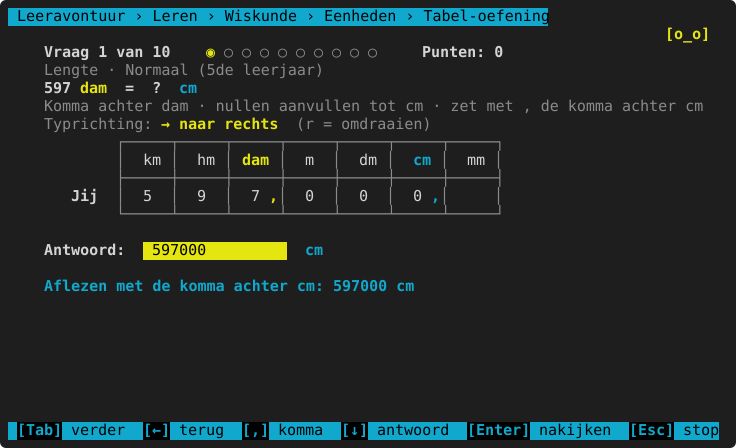

Na het nakijken staat onder je rij de **juiste rij**. Elk vakje is groen (juist) of rood (fout), en je ziet of je
antwoord, je tabel en je komma juist waren. Een tabel helemaal juist (cijfers en komma) geeft **+5 punten**.

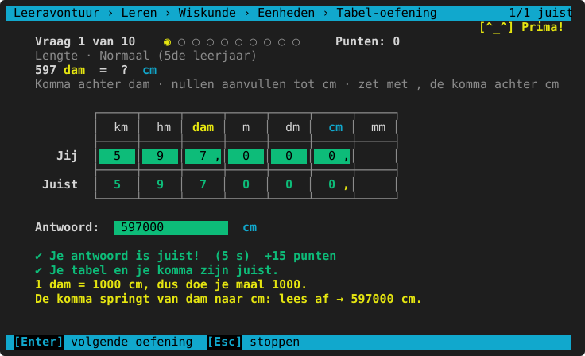

### Oppervlakte en volume

Bij oppervlakte heeft elke eenheid 2 vakjes (per eenheid × of : 100); de kop loopt over die 2 vakjes. Daaronder
staan **ha, a en ca** op de plaats van hm², dam² en m². Bij volume heeft elke eenheid 3 vakjes (× of : 1000), met
de liters (hl, dal, l, dl, cl, ml) eronder: zo zie je dat 1 dm³ = 1 l.

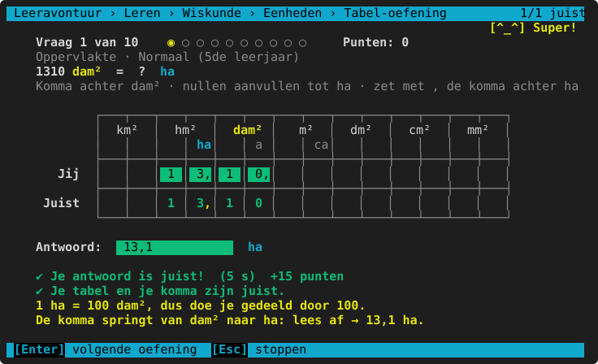

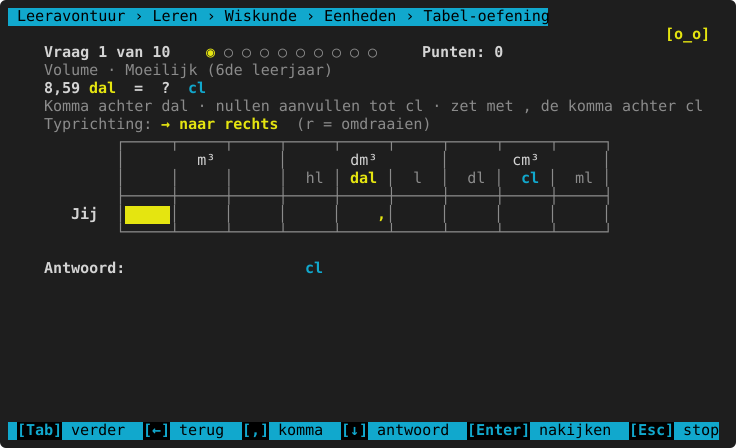

## Per leerjaar

<!-- auto:leerlijn wiskunde.eenheden.omzetten -->
|  | 3de leerjaar | 4de leerjaar | 5de leerjaar | 6de leerjaar | 1ste middelbaar |
|---|---|---|---|---|---|
| **komma hoogstens zoveel eenheden verschuiven** | 1 | 3 | 9 | idem | idem |
| **cijfers in het getal (van–tot)** | 1–1 | 1–2 | 1–3 | 2–4 | 2–5 |
| **cijfers na de komma in de vraag** | 0 | idem | 1 | 3 | idem |
| **cijfers na de komma in het antwoord** | 0 | idem | 2 | 3 | idem |
| **getal in de vraag kleiner dan** | 1000 | 10 000 | 100 000 | 1 000 000 | 10 000 000 |
| **antwoord kleiner dan** | 10 000 | 100 000 | 1 000 000 | 10 000 000 | 100 000 000 |
| **soorten eenheden** | lengte, massa, inhoud | idem | + oppervlakte | + volume | idem |
<!-- /auto -->

"Komma hoogstens zoveel eenheden verschuiven" = hoe ver de twee eenheden uit elkaar liggen (km → m is 3).

## Herkende denkfouten

<!-- auto:denkfouten wiskunde.eenheden.omzetten -->
- het getal overgeschreven zonder om te zetten
- de komma de verkeerde kant op geschoven
- een of meer kolommen te ver of te weinig geteld
- bij oppervlakte of volume maar 1 vakje per eenheid geteld
<!-- /auto -->

Bij "kolommen te ver of te weinig" zegt het programma ook hoeveel plaatsen en in welke richting.

## Spiekbrief

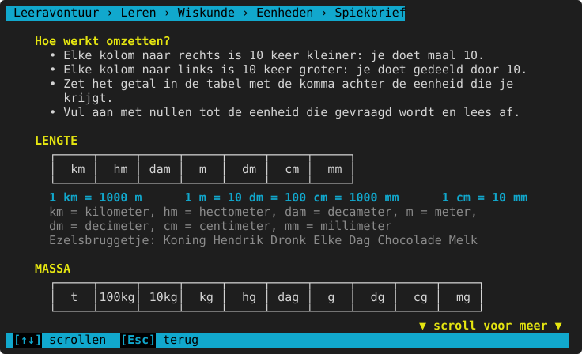

<!-- auto:spiekbrief wiskunde.eenheden.omzetten -->
```text
Hoe werkt omzetten?
  • Elke kolom naar rechts is 10 keer kleiner: je doet maal 10.
  • Elke kolom naar links is 10 keer groter: je doet gedeeld door 10.
  • Zet het getal in de tabel met de komma achter de eenheid die je krijgt.
  • Vul aan met nullen tot de eenheid die gevraagd wordt en lees af.

LENGTE
  ┌─────┬─────┬─────┬─────┬─────┬─────┬─────┐
  │  km │  hm │ dam │  m  │  dm │  cm │  mm │
  └─────┴─────┴─────┴─────┴─────┴─────┴─────┘
  1 km = 1000 m      1 m = 10 dm = 100 cm = 1000 mm      1 cm = 10 mm
  km = kilometer, hm = hectometer, dam = decameter, m = meter,
  dm = decimeter, cm = centimeter, mm = millimeter
  Ezelsbruggetje: Koning Hendrik Dronk Elke Dag Chocolade Melk

MASSA
  ┌─────┬─────┬─────┬─────┬─────┬─────┬─────┬─────┬─────┬─────┐
  │  t  │100kg│ 10kg│  kg │  hg │ dag │  g  │  dg │  cg │  mg │
  └─────┴─────┴─────┴─────┴─────┴─────┴─────┴─────┴─────┴─────┘
  1 t = 1000 kg      1 kg = 1000 g      1 g = 1000 mg      1 kg = 10 hg
  t = ton, kg = kilogram, hg = hectogram, dag = decagram, g = gram,
  dg = decigram, cg = centigram, mg = milligram
  Tussen t en kg zitten twee lege kolommen (100 kg en 10 kg).

VOORBEELD:  4,25 m = ? cm
  1. Zet 4,25 in de tabel met de komma achter m:
     ┌─────┬─────┬─────┬─────┬─────┬─────┬─────┐
     │  km │  hm │ dam │  m  │  dm │  cm │  mm │
     ├─────┼─────┼─────┼─────┼─────┼─────┼─────┤
     │     │     │     │  4 ,│  2  │  5  │     │
     └─────┴─────┴─────┴─────┴─────┴─────┴─────┘
  2. De komma springt naar cm. Lees af:
     ┌─────┬─────┬─────┬─────┬─────┬─────┬─────┐
     │  km │  hm │ dam │  m  │  dm │  cm │  mm │
     ├─────┼─────┼─────┼─────┼─────┼─────┼─────┤
     │     │     │     │  4  │  2  │  5 ,│     │
     └─────┴─────┴─────┴─────┴─────┴─────┴─────┘
  3. 4,25 m = 425 cm

  Nog een: 5 mm = ? m → 0 bij m, 0 bij dm, 0 bij cm, 5 bij mm → 0,005 m

INHOUD
  ┌─────┬─────┬─────┬─────┬─────┬─────┐
  │  hl │ dal │  l  │  dl │  cl │  ml │
  └─────┴─────┴─────┴─────┴─────┴─────┘
  1 l = 10 dl = 100 cl = 1000 ml      1 hl = 100 l
  hl = hectoliter, dal = decaliter, l = liter,
  dl = deciliter, cl = centiliter, ml = milliliter

OPPERVLAKTE  (5de leerjaar)
  ┌───┬───┬───┬───┬───┬───┬───┬───┬───┬───┬───┬───┬───┬───┐
  │  km²  │  hm²  │  dam² │   m²  │  dm²  │  cm²  │  mm²  │
  │   │   │   │ ha│   │ a │   │ ca│   │   │   │   │   │   │
  └───┴───┴───┴───┴───┴───┴───┴───┴───┴───┴───┴───┴───┴───┘
  Elke eenheid heeft 2 vakjes: per eenheid × of : 100.
  1 m² = 100 dm² = 10 000 cm²    1 ha = 1 hm² = 10 000 m²    1 a = 100 m²
  ha = hectare, a = are, ca = centiare (= 1 m²)

VOLUME  (6de leerjaar)
  ┌─────┬─────┬─────┬─────┬─────┬─────┬─────┬─────┬─────┐
  │        m³       │       dm³       │       cm³       │
  │     │     │     │  hl │ dal │  l  │  dl │  cl │  ml │
  └─────┴─────┴─────┴─────┴─────┴─────┴─────┴─────┴─────┘
  Elke eenheid heeft 3 vakjes: per eenheid × of : 1000.
  1 m³ = 1000 dm³      1 dm³ = 1 l      1 cm³ = 1 ml
  De literkolommen staan onder dm³ en cm³: zo zie je meteen dat 1 l = 1 dm³.
```
<!-- /auto -->

> **Voor het kind:** Naar een kleinere eenheid (km → m) wordt het getal groter: maal. Naar een grotere eenheid
> wordt het kleiner: gedeeld door. Twijfel je? Zet het getal in de tabel met de komma achter de eenheid die je
> hebt, vul aan met nullen en lees af bij de eenheid die gevraagd wordt.

Tijd, geld en snelheid staan apart: zie [Tijd, geld en snelheid](tijd-geld-snelheid.md).
