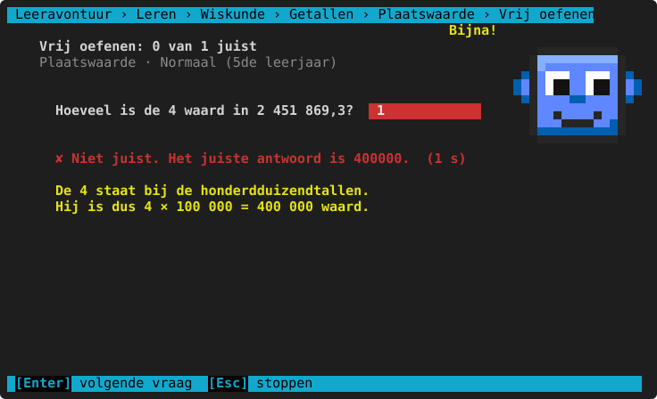
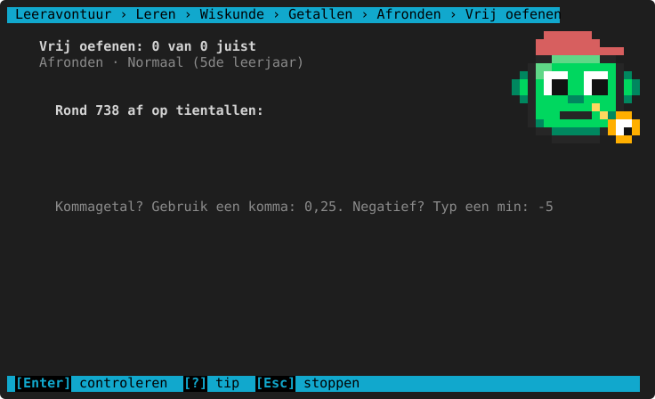
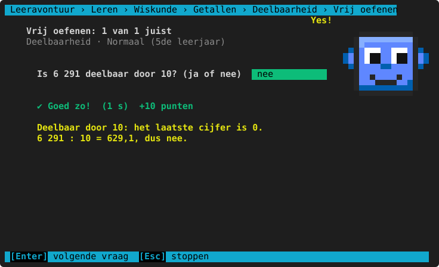
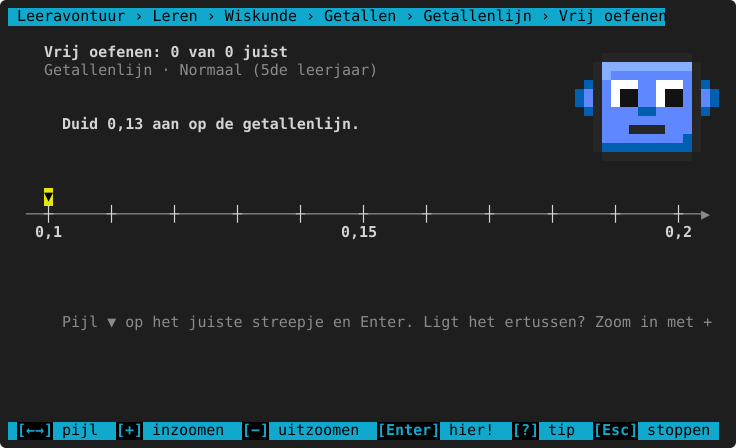
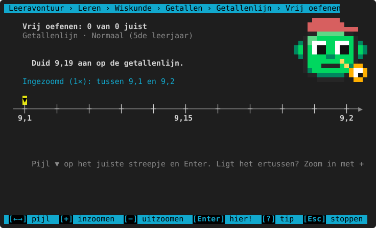
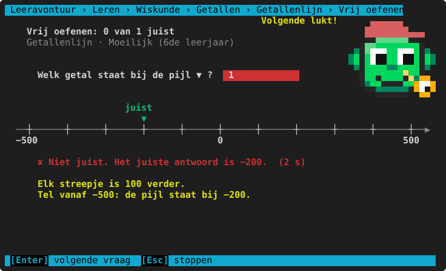

# Getallen

**Waar:** Leren & oefenen → Wiskunde → **Getallen** · [← terug naar de inhoud](../README.md)

Inzicht in getallen: wat elk cijfer waard is, afronden, deelbaarheid en de **getallenlijn** (aflezen, aanduiden
met inzoomen, sprongen en een thermometer).

## Plaatswaarde

"Welk cijfer staat bij de honderdtallen?" en "Hoeveel is de 4 waard?", met grote getallen en kommagetallen
(E, T, H, D … t, h, d). De uitleg zegt bij welke plaats het cijfer staat en wat het dus waard is.



**Per leerjaar**

<!-- auto:leerlijn wiskunde.getallen.plaatswaarde -->
|  | 3de leerjaar | 4de leerjaar | 5de leerjaar | 6de leerjaar | 1ste middelbaar |
|---|---|---|---|---|---|
| **hoogstens cijfers** | 4 | 5 | 7 | idem | idem |
| **hoogstens cijfers na de komma** | 0 | 2 | 3 | idem | idem |
<!-- /auto -->

**Herkende denkfouten**

<!-- auto:denkfouten wiskunde.getallen.plaatswaarde -->
- het cijfer gegeven in plaats van zijn waarde
- een plaats ernaast gekeken
<!-- /auto -->

## Afronden

Afronden op tientallen, honderdtallen … en vanaf het 5de op tienden. De uitleg kijkt naar het cijfer rechts:
5 of meer → naar boven.



**Per leerjaar**

<!-- auto:leerlijn wiskunde.getallen.afronden -->
|  | 3de leerjaar | 4de leerjaar | 5de leerjaar | 6de leerjaar | 1ste middelbaar |
|---|---|---|---|---|---|
| **afronden op** | tientallen, honderdtallen | tientallen, honderdtallen, duizendtallen, eenheden | tientallen, honderdtallen, duizendtallen, eenheden, tienden | tientallen, honderdtallen, duizendtallen, tienduizendtallen, eenheden, tienden, honderdsten | honderdtallen, duizendtallen, tienduizendtallen, honderdduizendtallen, eenheden, tienden, honderdsten |
| **hoogstens cijfers** | 3 | 5 | 6 | 7 | idem |
| **hoogstens cijfers na de komma** | 0 | 1 | 2 | 3 | idem |
<!-- /auto -->

**Herkende denkfouten**

<!-- auto:denkfouten wiskunde.getallen.afronden -->
- afgekapt in plaats van afgerond
- op de verkeerde plaats afgerond
<!-- /auto -->

## Deelbaarheid

Is een getal deelbaar door 2, 3, 4, 5, 9, 10 …? Het kind typt **ja** of **nee** (ook `j` of `n`). Verder: hoeveel
delers heeft een getal, en vanaf het 6de priemgetallen, de grootste gemene deler (ggd) en het kleinste gemeen
veelvoud (kgv). De uitleg geeft het kenmerk ("het laatste cijfer is 0").



**Per leerjaar**

<!-- auto:leerlijn wiskunde.getallen.deelbaarheid -->
|  | 3de leerjaar | 4de leerjaar | 5de leerjaar | 6de leerjaar | 1ste middelbaar |
|---|---|---|---|---|---|
| **soorten vragen** | deelbaar door …? | idem | + alle delers | + priemgetal?, ggd, kgv | deelbaar door …?, priemgetal?, ggd, kgv |
| **deelbaar door** | 2, 5, 10 | + 100 | + 3, 4, 9, 25 | + 6 | 3, 4, 6, 9, 25 |
| **getallen tot** | 100 | 1000 | 10 000 | 100 000 | 1 000 000 |
<!-- /auto -->

**Herkende denkfouten**

<!-- auto:denkfouten wiskunde.getallen.deelbaarheid -->
- het kenmerk van deelbaarheid verkeerd toegepast
<!-- /auto -->

## Getallenlijn

Vier soorten vragen:
- **Aflezen**: welk getal staat bij de pijl ▼? (typ het getal)
- **Aanduiden**: zet zelf de pijl op het juiste streepje.
- **Sprongen**: plus = naar rechts, min = naar links.
- **Thermometer**: temperaturen, ook onder 0 °C.



**Zo duid je aan:**

| Toets of muis | Wat het doet |
|---|---|
| `←` `→` | De pijl ▼ een streepje verplaatsen. |
| Klik op een streepje | De pijl daar zetten. |
| `+` of het scrollwiel omhoog | **Inzoomen**: het stuk tussen twee streepjes wordt de nieuwe lijn, met 10 keer kleinere stappen. |
| `−` of het scrollwiel omlaag | Weer uitzoomen. |
| `Enter` | Hier! (nakijken) |

Ligt het getal tussen twee streepjes (bv. 9,19 op een lijn met stappen van 0,1), dan zet je de pijl op het
streepje ervoor en zoom je in:



Na het nakijken staat het juiste streepje er groen bij ("juist ▼").



**Per leerjaar**

<!-- auto:leerlijn wiskunde.getallen.getallenlijn -->
|  | 3de leerjaar | 4de leerjaar | 5de leerjaar | 6de leerjaar | 1ste middelbaar |
|---|---|---|---|---|---|
| **soorten vragen** | aflezen, aanduiden, sprongen | idem | + thermometer | idem | idem |
| **getallen tot** | 1000 | 10 000 | idem | 100 000 | idem |
| **hoogstens cijfers na de komma** | 0 | 1 | 2 | 3 | idem |
| **ook negatieve getallen** | nee | idem | ja | idem | idem |
<!-- /auto -->

**Herkende denkfouten**

<!-- auto:denkfouten wiskunde.getallen.getallenlijn -->
- één streepje ernaast
- niet ver genoeg ingezoomd
- de verkeerde kant op gesprongen
<!-- /auto -->

## Spiekbrief

<!-- auto:spiekbrief wiskunde.getallen.plaatswaarde -->
```text
PLAATSWAARDE
  M  HD  TD  D  H  T  E , t  h  d
  M = miljoenen, HD = honderdduizendtallen, TD = tienduizendtallen,
  D = duizendtallen, H = honderdtallen, T = tientallen, E = eenheden,
  t = tienden, h = honderdsten, d = duizendsten
  In 3 405,7 is de 4 vierhonderd waard (4 H), de 7 zeven tienden (0,7).

AFRONDEN
  Kijk naar het cijfer rechts: 0-4 naar beneden, 5-9 naar boven.
  3 467 op honderdtallen: rechts van de 4 staat een 6, dus 3 500.

DEELBAAR DOOR …
    2: het laatste cijfer is even (0, 2, 4, 6 of 8)
    3: de som van de cijfers is deelbaar door 3
    4: het getal gevormd door de laatste twee cijfers is deelbaar door 4
    5: het laatste cijfer is 0 of 5
    6: het getal is deelbaar door 2 én door 3
    9: de som van de cijfers is deelbaar door 9
   10: het laatste cijfer is 0
   25: het eindigt op 00, 25, 50 of 75
  100: het eindigt op 00
  Priemgetal: precies 2 delers (1 en zichzelf): 2, 3, 5, 7, 11, 13, 17 …
  ggd = grootste gemene deler, kgv = kleinste gemeen veelvoud.

GETALLENLIJN
  Hoeveel is één streepje waard? Plus = naar rechts, min = naar links.
  Tussen twee streepjes? Zoom in met +: 10 kleinere streepjes.
  Onder nul: −5 is kouder (kleiner) dan −2. Hoe verder links, hoe kleiner.
```
<!-- /auto -->

> **Voor het kind:** Op de getallenlijn: tel eerst hoeveel elke stap waard is (kijk naar twee getallen en tel de
> streepjes ertussen). Ligt je getal ertussen? Zoom in met `+`.
