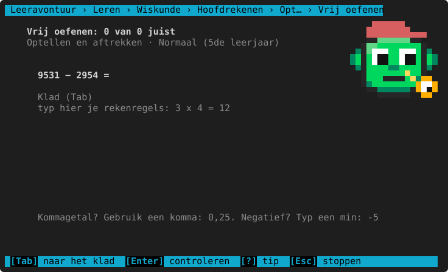
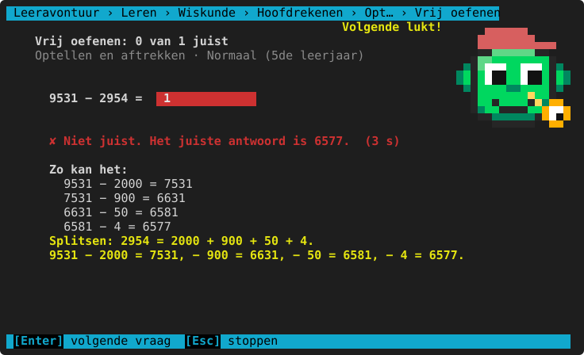
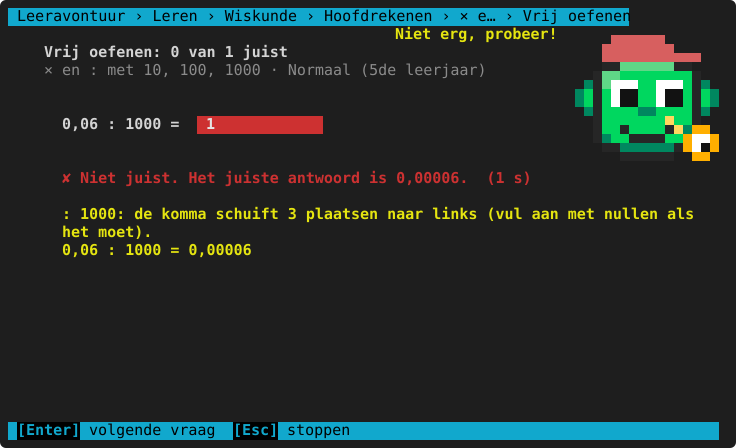
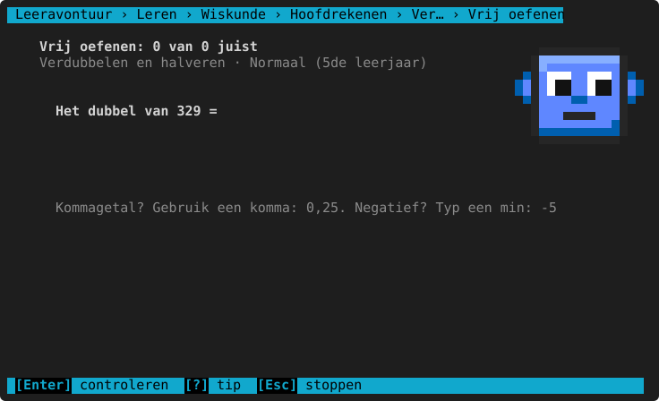

# Hoofdrekenen

**Waar:** Leren & oefenen → Wiskunde → **Hoofdrekenen** · [← terug naar de inhoud](../README.md)

Rekenen uit het hoofd, met een **slimme strategie** in elke uitleg: compenseren, splitsen, × 9 = × 10 − 1,
verdubbelen … Zo leert het kind niet alleen het antwoord, maar ook een manier om het snel te vinden.
De vragen typ je gewoon in het antwoordvak; zie [Vrij oefenen](../README.md#vrij-oefenen) voor tip, uitleg en
punten. Tafels en plus en min kun je ook tegen de klok oefenen bij [Snelrekenen](../snelrekenen.md).

## Maal- en deeltafels

De tafels van vermenigvuldiging en de deeltafels (`56 : 7 =`), later ook met tientallen (`7 × 80`) en in het
1ste middelbaar met negatieve getallen.


De uitleg toont een strategie die past bij de tafel: × 9 = × 10 min één keer, × 5 = de helft van × 10,
× 4 = twee keer verdubbelen, of "ken je 6 × 2? Dan nog 6 erbij".


**Per leerjaar**

<!-- auto:leerlijn wiskunde.hoofdrekenen.tafels -->
|  | 3de leerjaar | 4de leerjaar | 5de leerjaar | 6de leerjaar | 1ste middelbaar |
|---|---|---|---|---|---|
| **tafels** | 1, 2, 3, 4, 5, 10 | + 6, 7, 8, 9 | 2, 3, 4, 5, 6, 7, 8, 9 | 3, 4, 6, 7, 8, 9, 11, 12 | idem |
| **tafel tot** | 10 | idem | idem | 12 | idem |
| **ook deeltafels** | nee | ja | idem | idem | idem |
| **ook met tientallen (7 × 80)** | nee | idem | ja | idem | idem |
| **ook negatieve getallen** | nee | idem | idem | idem | ja |
<!-- /auto -->

**Herkende denkfouten**

<!-- auto:denkfouten wiskunde.hoofdrekenen.tafels -->
- opgeteld in plaats van vermenigvuldigd
- één stap ernaast in de tafel
- vermenigvuldigd in plaats van gedeeld
<!-- /auto -->

## Optellen en aftrekken

Uit het hoofd optellen en aftrekken met grotere getallen, later met kommagetallen en negatieve getallen.



De uitleg kiest de handigste strategie: **compenseren** (`47 + 99 = 47 + 100 − 1`) bij een getal dat bijna
rond is, anders **splitsen** in honderdtallen, tientallen en eenheden.



**Per leerjaar**

<!-- auto:leerlijn wiskunde.hoofdrekenen.plusmin -->
|  | 3de leerjaar | 4de leerjaar | 5de leerjaar | 6de leerjaar | 1ste middelbaar |
|---|---|---|---|---|---|
| **getallen tot** | 100 | 1000 | 10 000 | idem | idem |
| **hoogstens cijfers na de komma** | 0 | idem | idem | 2 | idem |
| **ook negatieve getallen** | nee | idem | idem | idem | ja |
<!-- /auto -->

**Herkende denkfouten**

<!-- auto:denkfouten wiskunde.hoofdrekenen.plusmin -->
- bij compenseren de verkeerde kant op verbeterd
- een tiental of honderdtal vergeten (onthouden)
- opgeteld en afgetrokken door elkaar
<!-- /auto -->

## × en : met 10, 100, 1000

Vermenigvuldigen en delen met 10, 100, 1000 (en in het 1ste middelbaar ook met 0,1 en 0,01): de komma
verschuift.



**Per leerjaar**

<!-- auto:leerlijn wiskunde.hoofdrekenen.maaldeel10 -->
|  | 3de leerjaar | 4de leerjaar | 5de leerjaar | 6de leerjaar | 1ste middelbaar |
|---|---|---|---|---|---|
| **× en : met** | — | 10, 100 | + 1000 | idem | + 0,1, 0,01 |
| **hoogstens cijfers na de komma** | — | 0 | 2 | 3 | idem |
| **getallen tot** | — | 1000 | 10 000 | idem | idem |

— = komt nog niet aan bod in het 3de leerjaar: dat niveau kun je dan niet kiezen (er staat "nog niet in dit leerjaar").
<!-- /auto -->

**Herkende denkfouten**

<!-- auto:denkfouten wiskunde.hoofdrekenen.maaldeel10 -->
- de komma de verkeerde kant op geschoven
- de komma te ver of te weinig geschoven
<!-- /auto -->

## Verdubbelen en halveren

Het dubbel en de helft uit het hoofd, door te splitsen: het dubbel van 37 = het dubbel van 30 + het dubbel van 7.



**Per leerjaar**

<!-- auto:leerlijn wiskunde.hoofdrekenen.dubbelhelft -->
|  | 3de leerjaar | 4de leerjaar | 5de leerjaar | 6de leerjaar | 1ste middelbaar |
|---|---|---|---|---|---|
| **getallen tot** | 50 | 200 | 1000 | idem | 10 000 |
| **hoogstens cijfers na de komma** | 0 | idem | idem | 1 | 2 |
<!-- /auto -->

**Herkende denkfouten**

<!-- auto:denkfouten wiskunde.hoofdrekenen.dubbelhelft -->
- het dubbel en de helft verwisseld
- een tiental vergeten
<!-- /auto -->

## Spiekbrief

<!-- auto:spiekbrief wiskunde.hoofdrekenen.tafels -->
```text
Slimme trucjes voor hoofdrekenen

COMPENSEREN  (een getal dat bijna rond is)
  47 + 99  = 47 + 100 − 1  = 146
  523 − 198 = 523 − 200 + 2 = 325

SPLITSEN
  347 + 285 = 347 + 200 + 80 + 5 = 632

TAFELS
  × 9  = × 10 en dan één keer eraf:  9 × 7 = 70 − 7 = 63
  × 5  = de helft van × 10:          5 × 8 = 80 : 2 = 40
  × 4  = twee keer verdubbelen:       4 × 6 → 12 → 24
  7 × 80 = 7 × 8 = 56, en dan × 10 = 560
  Delen = omgekeerd vermenigvuldigen: 56 : 7 = ? → 7 × 8 = 56, dus 8

× EN : MET 10, 100, 1000
  × 10 : de komma 1 plaats naar rechts   3,5 × 10 = 35
  : 100: de komma 2 plaatsen naar links  35 : 100 = 0,35
  × 0,1 is hetzelfde als : 10

VERDUBBELEN EN HALVEREN
  dubbel van 37 = dubbel van 30 + dubbel van 7 = 60 + 14 = 74
  helft van 74 = helft van 60 + helft van 14 = 30 + 7 = 37

NEGATIEVE GETALLEN
  −3 + 5 = 2   (op de getallenlijn 5 naar rechts)
  plus maal min = min, min maal min = plus
```
<!-- /auto -->

> **Voor het kind:** Lees na een fout de uitleg goed: daar staat een trucje dat je de volgende keer helpt.
> Met `?` krijg je een tip zonder dat het antwoord verklapt wordt.
