# Meetkunde

**Waar:** Leren & oefenen → Wiskunde → **Meetkunde** · [← terug naar de inhoud](../README.md)

Oppervlakte en omtrek op een rooster, formules, hoeken, coördinaten (de schatkaart en het assenstelsel) en schaal.

## Oppervlakte en omtrek

Een figuur op een rooster met vakjes van 1 cm². **Oppervlakte** = tel de vakjes (cm²); **omtrek** = tel de
randjes rondom (cm). Na het nakijken van een omtrekvraag staat de rand in het **groen**.

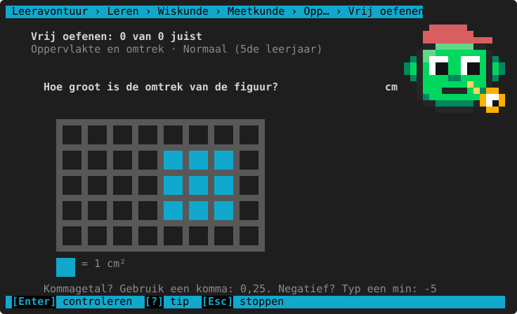

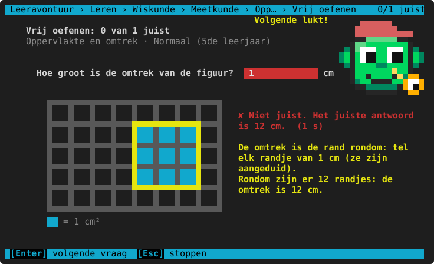

Er zijn rechthoeken, L-vormen en trappen, en vanaf het 5de driehoeken met **halve vakjes** (▒▒▒): twee halve
vakjes = één heel. Bij een driehoek vraagt het programma alleen de oppervlakte.

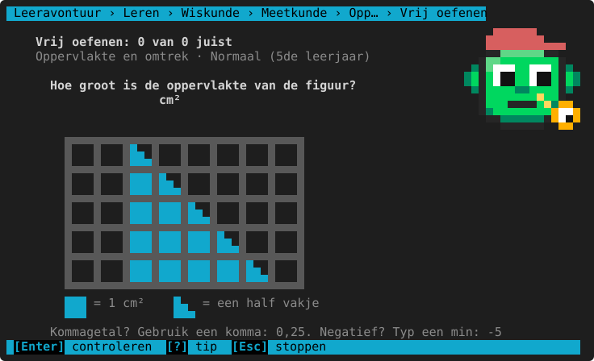

**Per leerjaar**

<!-- auto:leerlijn wiskunde.meetkunde.rooster -->
|  | 3de leerjaar | 4de leerjaar | 5de leerjaar | 6de leerjaar | 1ste middelbaar |
|---|---|---|---|---|---|
| **soorten vragen** | oppervlakte, omtrek | idem | idem | idem | idem |
| **figuren** | rechthoek | + L-vorm | + trap, driehoek | L-vorm, trap, driehoek | idem |
| **rooster: rijen** | 4 | 5 | idem | idem | idem |
| **rooster: kolommen** | 6 | 8 | idem | idem | idem |
<!-- /auto -->

**Herkende denkfouten**

<!-- auto:denkfouten wiskunde.meetkunde.rooster -->
- omtrek en oppervlakte verwisseld
- ook de randjes binnenin de figuur geteld
- halve vakjes als hele geteld
- de halve vakjes vergeten
<!-- /auto -->

## Formules

Oppervlakte en omtrek uitrekenen met een formule: rechthoek en vierkant (vanaf het 4de), driehoek (5de),
parallellogram, trapezium, cirkel (π = 3,14) en het volume van een balk en een kubus (6de). In het 1ste middelbaar
ook met afmetingen als 4,5 cm. De uitleg toont de formule met de getallen ingevuld; bij een cirkel met de diameter
rekent ze eerst de straal uit.

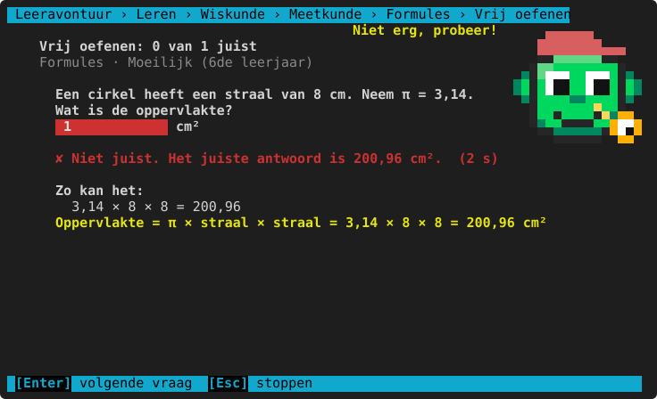

**Per leerjaar**

<!-- auto:leerlijn wiskunde.meetkunde.formules -->
|  | 3de leerjaar | 4de leerjaar | 5de leerjaar | 6de leerjaar | 1ste middelbaar |
|---|---|---|---|---|---|
| **soorten vragen** | — | omtrek rechthoek, omtrek vierkant, opp. rechthoek, opp. vierkant | + opp. driehoek | + opp. parallellogram, opp. trapezium, omtrek cirkel, opp. cirkel, volume balk, volume kubus | idem |
| **afmetingen tot (cm)** | — | 10 | 12 | 15 | 20 |
| **ook afmetingen met ,5** | — | nee | idem | idem | ja |

— = komt nog niet aan bod in het 3de leerjaar: dat niveau kun je dan niet kiezen (er staat "nog niet in dit leerjaar").
<!-- /auto -->

**Herkende denkfouten**

<!-- auto:denkfouten wiskunde.meetkunde.formules -->
- vergeten te delen door 2
- de omtrek berekend in plaats van de oppervlakte
- de oppervlakte berekend in plaats van de omtrek
- maar 2 zijden opgeteld voor de omtrek
- straal en diameter verwisseld
<!-- /auto -->

## Hoeken

Wat voor hoek is dit? Bij een **tekening** of een **aantal graden**. Typ `scherp`, `recht`, `stomp`, `gestrekt` of
`vol` (ook `scherpe hoek` of `stompe` mag). Vanaf het 6de: de derde hoek van een driehoek (samen 180°); in het
1ste middelbaar: nevenhoeken.

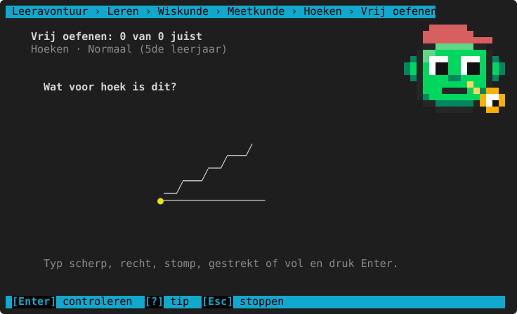

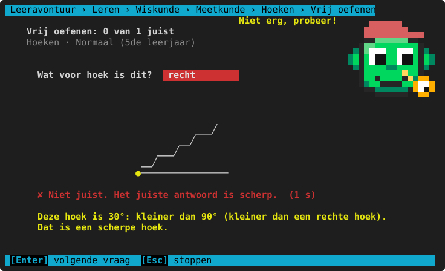

**Per leerjaar**

<!-- auto:leerlijn wiskunde.meetkunde.hoeken -->
|  | 3de leerjaar | 4de leerjaar | 5de leerjaar | 6de leerjaar | 1ste middelbaar |
|---|---|---|---|---|---|
| **soorten vragen** | — | bij een tekening, bij een aantal graden | idem | + de derde hoek van een driehoek | bij een aantal graden, de derde hoek van een driehoek, nevenhoeken |
| **soorten hoeken** | — | scherp, recht, stomp | + gestrekt | + vol | idem |

— = komt nog niet aan bod in het 3de leerjaar: dat niveau kun je dan niet kiezen (er staat "nog niet in dit leerjaar").
<!-- /auto -->

**Herkende denkfouten**

<!-- auto:denkfouten wiskunde.meetkunde.hoeken -->
- scherp en stomp verwisseld
- de som van de hoeken in een driehoek is 180°
- nevenhoeken zijn samen 180°
<!-- /auto -->

## Schatkaart (coördinaten)

Een kaart met kolommen A, B, C … (onderaan) en rijen 1, 2, 3 … (links; rij 1 staat onderaan).

- **Waar ligt de schat ✦?** Typ eerst de letter, dan het getal: `C4` (ook `c 4` of `(C, 4)`).

  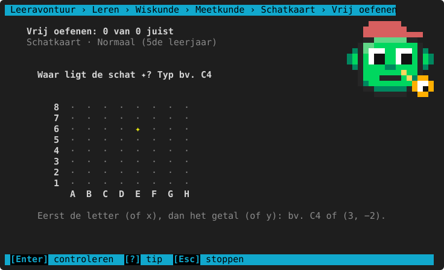

- **Zet een kruisje op …**: verplaats het kruisje `[ ]` met de **pijltjes** en druk Enter, of **klik** meteen op
  het punt. Rechts staat waar je staat ("Jij: C6"). Na het nakijken: ✔ of ✘, en bij een fout het juiste punt ●.

  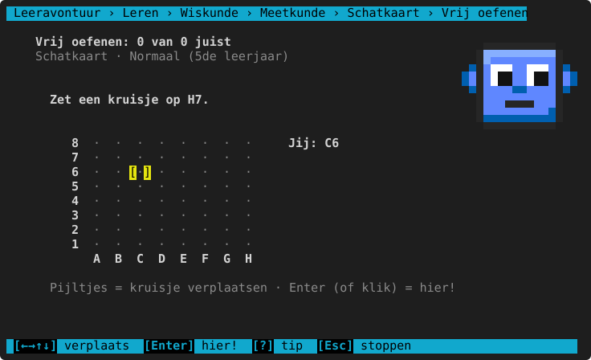

In het 1ste middelbaar komt er een **assenstelsel** van −5 tot 5 bij: eerst x (horizontaal), dan y (verticaal).
Typ bv. `(3, -2)` of `3 -2`.

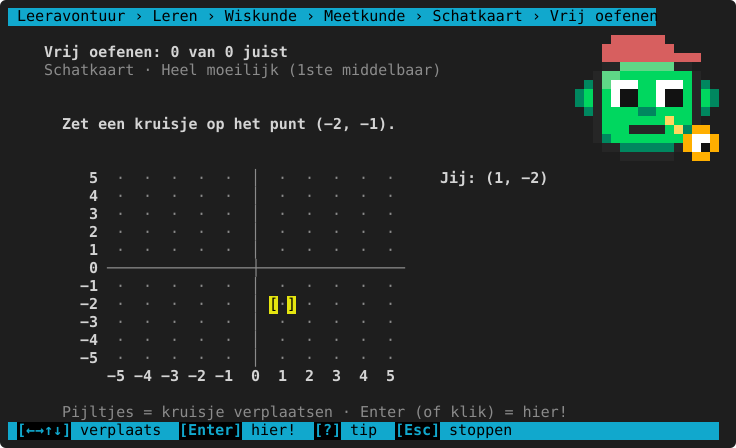

**Per leerjaar**

<!-- auto:leerlijn wiskunde.meetkunde.coordinaten -->
|  | 3de leerjaar | 4de leerjaar | 5de leerjaar | 6de leerjaar | 1ste middelbaar |
|---|---|---|---|---|---|
| **soorten vragen** | — | aflezen, aanduiden | idem | idem | + assenstelsel: aflezen, assenstelsel: aanduiden |
| **schatkaart: kolommen** | — | 6 | 8 | 10 | idem |
| **schatkaart: rijen** | — | 6 | 8 | 10 | idem |
| **assenstelsel van −n tot n** | — | nee (schatkaart) | idem | idem | −5 … 5 |

— = komt nog niet aan bod in het 3de leerjaar: dat niveau kun je dan niet kiezen (er staat "nog niet in dit leerjaar").
<!-- /auto -->

**Herkende denkfouten**

<!-- auto:denkfouten wiskunde.meetkunde.coordinaten -->
- kolom en rij (x en y) omgewisseld
- de rijen van boven geteld in plaats van van onder
<!-- /auto -->

## Schaal

Vanaf het 6de leerjaar: van de kaart naar het echt ("1 : 1000, 3 cm op de kaart = ? m") en terug, en in het
1ste middelbaar de schaal zoeken (typ `1:5000` of `5000`). De uitleg zet eerst alles om naar cm.

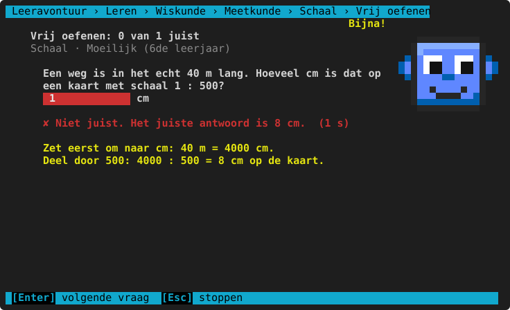

**Per leerjaar**

<!-- auto:leerlijn wiskunde.meetkunde.schaal -->
|  | 3de leerjaar | 4de leerjaar | 5de leerjaar | 6de leerjaar | 1ste middelbaar |
|---|---|---|---|---|---|
| **soorten vragen** | — | — | — | kaart → echt, echt → kaart | + de schaal zoeken |
| **schalen** | — | — | — | 1 : 100, 1 : 200, 1 : 500, 1 : 1000, 1 : 2000, 1 : 5000 | 1 : 500, 1 : 1000, 1 : 5000, 1 : 10 000, 1 : 25 000, 1 : 50 000, 1 : 100 000 |

— = komt nog niet aan bod in het 3de leerjaar, 4de leerjaar en 5de leerjaar: dat niveau kun je dan niet kiezen (er staat "nog niet in dit leerjaar").
<!-- /auto -->

**Herkende denkfouten**

<!-- auto:denkfouten wiskunde.meetkunde.schaal -->
- cm niet omgezet naar m of km (of omgekeerd)
- gedeeld in plaats van vermenigvuldigd (of omgekeerd)
<!-- /auto -->

## Spiekbrief

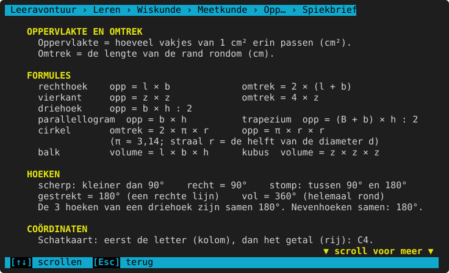

<!-- auto:spiekbrief wiskunde.meetkunde.rooster -->
```text
OPPERVLAKTE EN OMTREK
  Oppervlakte = hoeveel vakjes van 1 cm² erin passen (cm²).
  Omtrek = de lengte van de rand rondom (cm).

FORMULES
  rechthoek    opp = l × b             omtrek = 2 × (l + b)
  vierkant     opp = z × z             omtrek = 4 × z
  driehoek     opp = b × h : 2
  parallellogram  opp = b × h          trapezium  opp = (B + b) × h : 2
  cirkel       omtrek = 2 × π × r      opp = π × r × r
               (π ≈ 3,14; straal r = de helft van de diameter d)
  balk         volume = l × b × h      kubus  volume = z × z × z

HOEKEN
  scherp: kleiner dan 90°    recht = 90°    stomp: tussen 90° en 180°
  gestrekt = 180° (een rechte lijn)    vol = 360° (helemaal rond)
  De 3 hoeken van een driehoek zijn samen 180°. Nevenhoeken samen: 180°.

COÖRDINATEN
  Schatkaart: eerst de letter (kolom), dan het getal (rij): C4.
  Rij 1 staat onderaan.
  Assenstelsel: eerst x (horizontaal), dan y (verticaal): (3, −2).

SCHAAL
  1 : 1000 = 1 cm op de kaart is 1000 cm (10 m) in het echt.
  Kaart → echt: × de schaal.   Echt → kaart: : de schaal.
  Let op de eenheden: 100 cm = 1 m, 100 000 cm = 1 km.
```
<!-- /auto -->

> **Voor het kind:** Oppervlakte = vakjes binnenin, omtrek = de rand rondom. Op de schatkaart: eerst door de gang
> (de letter), dan de trap op (het getal).
