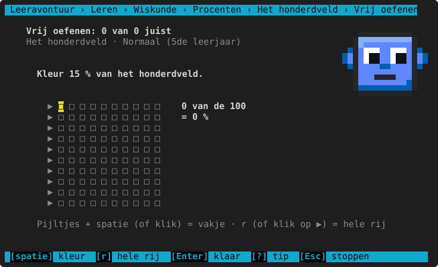
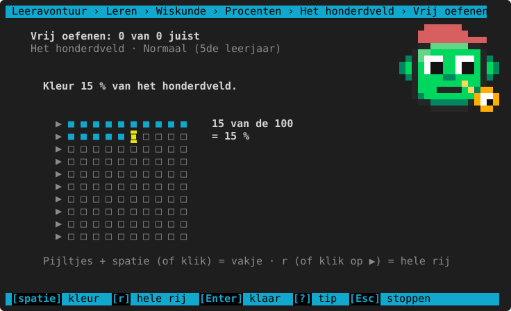
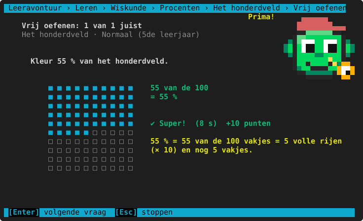
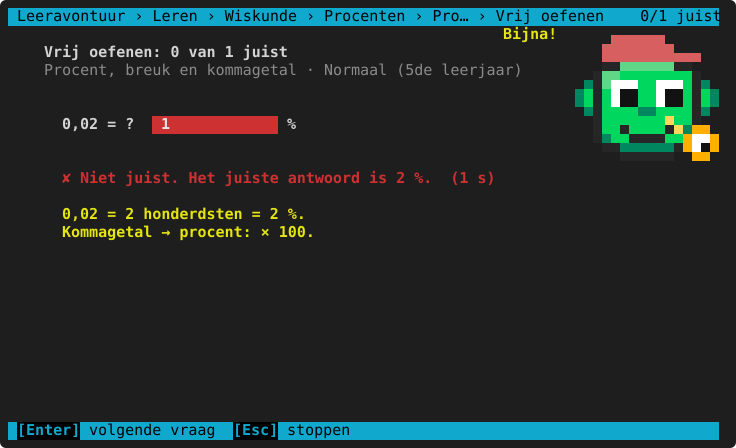
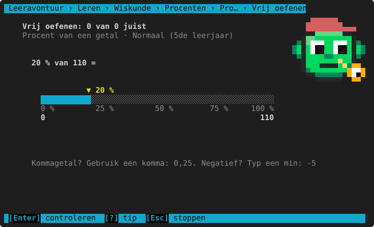
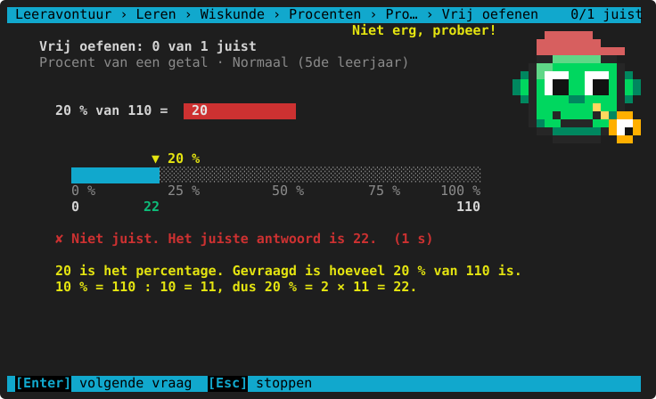
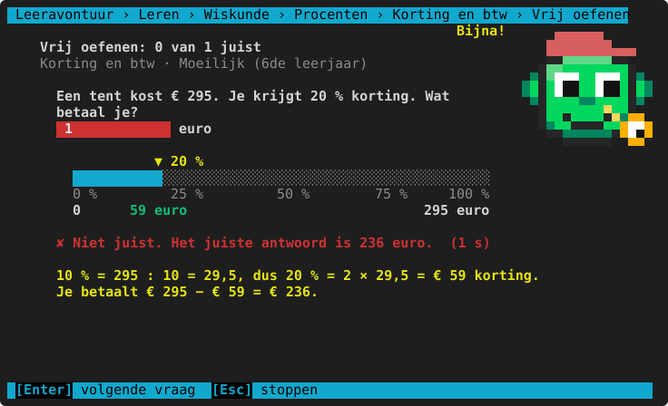

# Procenten

**Waar:** Leren & oefenen → Wiskunde → **Procenten** · [← terug naar de inhoud](../README.md) · vanaf het 5de leerjaar

Procent = per honderd. Het kind leert het met het **honderdveld** (10 × 10 vakjes), zet procenten om naar breuken
en kommagetallen, rekent een procent van een getal uit met de **procentstrook** en (vanaf het 6de) korting en btw.
Een `%` achter je antwoord mag, een `€` voor een bedrag ook.

## Het honderdveld

Aflezen ("Welk percentage is gekleurd?") en zelf kleuren ("Kleur 15 % van het honderdveld", of een breuk:
"Kleur 3/4").



| Toets of muis | Wat het doet |
|---|---|
| Pijltjes | Naar een ander vakje. |
| Spatie of klik op een vakje | Dat vakje kleuren (of weer wit maken). |
| `r` of klik op ▶ | De **hele rij** kleuren (of leegmaken als ze al vol is): 10 vakjes = 10 %. |
| `Enter` | Klaar: nakijken. |

Rechts telt het mee: "15 van de 100 = 15 %".





**Per leerjaar**

<!-- auto:leerlijn wiskunde.procenten.honderdveld -->
|  | 3de leerjaar | 4de leerjaar | 5de leerjaar | 6de leerjaar | 1ste middelbaar |
|---|---|---|---|---|---|
| **soorten vragen** | — | — | aflezen, kleuren | + breuk kleuren | aflezen, breuk kleuren |
| **alleen vijfvouden** | — | — | ja | nee | idem |

— = komt nog niet aan bod in het 3de leerjaar en 4de leerjaar: dat niveau kun je dan niet kiezen (er staat "nog niet in dit leerjaar").
<!-- /auto -->

**Herkende denkfouten**

<!-- auto:denkfouten wiskunde.procenten.honderdveld -->
- de witte vakjes geteld in plaats van de gekleurde
- een kommagetal gegeven in plaats van een percentage
<!-- /auto -->

## Procent, breuk en kommagetal

`25 % = 1/4 = 0,25`: van procent naar breuk (zo eenvoudig mogelijk) of kommagetal, en terug.



**Per leerjaar**

<!-- auto:leerlijn wiskunde.procenten.omzetten -->
|  | 3de leerjaar | 4de leerjaar | 5de leerjaar | 6de leerjaar |
|---|---|---|---|---|
| **soorten vragen** | — | — | % → breuk, breuk → %, kommagetal → % | + % → kommagetal |

— = komt nog niet aan bod in het 3de leerjaar en 4de leerjaar: dat niveau kun je dan niet kiezen (er staat "nog niet in dit leerjaar").
<!-- /auto -->

**Herkende denkfouten**

<!-- auto:denkfouten wiskunde.procenten.omzetten -->
- kommagetal en procent: de komma 2 plaatsen verkeerd
- niet volledig vereenvoudigd
<!-- /auto -->

## Procent van een getal

`20 % van 80` en "Hoeveel procent is 12 van 48?". De **procentstrook** toont 0 % … 100 % boven 0 … het totaal;
na het nakijken staat het deel onder de pijl. De uitleg kiest een handige strategie ("10 % = 8, dus 20 % = 16").





**Per leerjaar**

<!-- auto:leerlijn wiskunde.procenten.van -->
|  | 3de leerjaar | 4de leerjaar | 5de leerjaar | 6de leerjaar | 1ste middelbaar |
|---|---|---|---|---|---|
| **soorten vragen** | — | — | procent van een getal | + hoeveel %? | idem |
| **procenten** | — | — | 10, 20, 25, 50, 75 | + 5, 15, 30, 40, 60, 80 | 1, 2, 4, 5, 8, 12, 15, 35, 45, 65, 85 |
| **getallen tot** | — | — | 200 | 400 | 600 |

— = komt nog niet aan bod in het 3de leerjaar en 4de leerjaar: dat niveau kun je dan niet kiezen (er staat "nog niet in dit leerjaar").
<!-- /auto -->

**Herkende denkfouten**

<!-- auto:denkfouten wiskunde.procenten.van -->
- het percentage zelf als antwoord gegeven
- door het percentage gedeeld
- het andere deel berekend (100 % − …)
<!-- /auto -->

## Korting en btw

Wat betaal je met korting? Wat kost iets met btw (6 % of 21 %)? In het 1ste middelbaar ook procentuele stijging en
daling ("Hoeveel procent duurder?").



**Per leerjaar**

<!-- auto:leerlijn wiskunde.procenten.korting -->
|  | 3de leerjaar | 4de leerjaar | 5de leerjaar | 6de leerjaar | 1ste middelbaar |
|---|---|---|---|---|---|
| **soorten vragen** | — | — | — | korting, btw | + stijging, daling |

— = komt nog niet aan bod in het 3de leerjaar, 4de leerjaar en 5de leerjaar: dat niveau kun je dan niet kiezen (er staat "nog niet in dit leerjaar").
<!-- /auto -->

**Herkende denkfouten**

<!-- auto:denkfouten wiskunde.procenten.korting -->
- alleen de korting berekend (niet afgetrokken van de prijs)
- de korting bij de prijs opgeteld
- de btw niet bij de prijs geteld
- het procent berekend van het verkeerde bedrag
<!-- /auto -->

## Spiekbrief

<!-- auto:spiekbrief wiskunde.procenten.honderdveld -->
```text
PROCENT = PER HONDERD
  35 % = 35 van de 100 = 35/100 = 0,35

HANDIG OM TE KENNEN
  100 % = alles      50 % = 1/2      25 % = 1/4      75 % = 3/4
  20 % = 1/5         10 % = 1/10     5 % = 1/20      1 % = 1/100

PROCENT VAN EEN GETAL
  20 % van 80: 10 % = 80 : 10 = 8, dus 20 % = 2 × 8 = 16.
  25 % van 80: 1/4 van 80 = 80 : 4 = 20.
  Hoeveel % is 12 van 48? 12/48 = 1/4 = 25 %.

KORTING EN BTW
  Korting: nieuwe prijs = prijs − het procent van de prijs.
  € 240 met 25 % korting: 25 % van 240 = 60, je betaalt 240 − 60 = € 180.
  Btw: prijs met btw = prijs + het procent van de prijs (6 % of 21 %).
```
<!-- /auto -->

> **Voor het kind:** 10 % is een tiende (: 10), 50 % de helft, 25 % een vierde. Bij korting trek je het af van
> de prijs, bij btw tel je het erbij.
