# Tijd, geld en snelheid

**Waar:** Leren & oefenen → Wiskunde → **Tijd, geld en snelheid** · [← terug naar de inhoud](../README.md)

Grootheden die niet met de eenhedentabel werken. Tijd rekent met **60**, niet met 100: daar gaat het vaak mis, en
daar zoekt het programma naar.

## Tijd

Omrekenen (u, min, s, dagen, weken, maanden), uren en minuten samen, een tijdsduur en een aankomstuur.

**Zo typ je een antwoord:**

| Vraag | Typ bv. | Ook goed |
|---|---|---|
| `2 u 15 min = ? min` | `135` | `135 min` |
| `135 min = ? u ? min` | `2 u 15 min` | `2u15`, `2 uur 15 minuten` (minuten hoogstens 59) |
| `Hoe laat kom je aan?` | `11.15` | `11:15`, `11 u 15`, `11u15`, `1115`, `11 u` |

Alleen "135" typen bij "135 min = ? u ? min" telt niet: dan vraagt het programma uren en minuten.

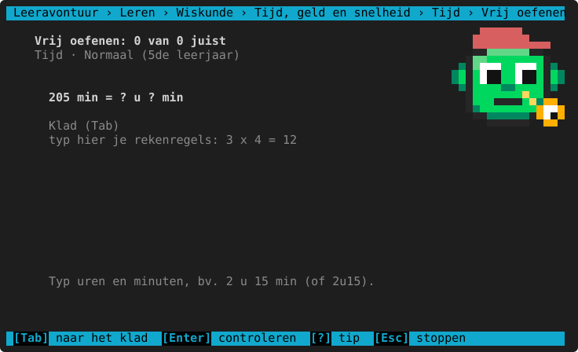

Wie met 100 rekent in plaats van 60, krijgt daar uitleg over:

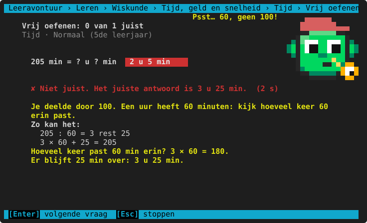

Bij een tijdsduur en een aankomstuur telt de uitleg in stapjes tot het volle uur:

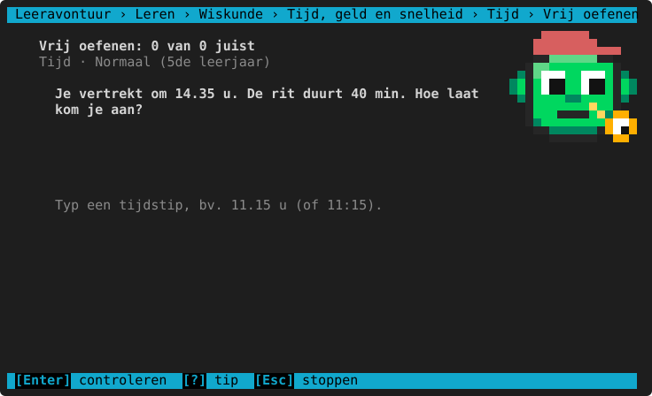

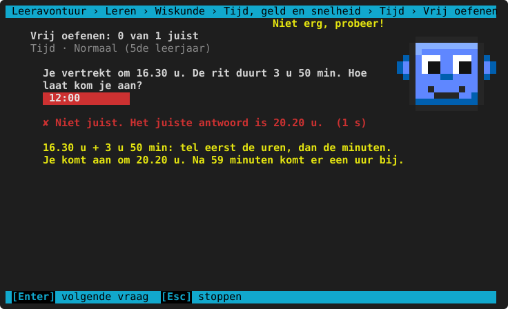

**Per leerjaar**

<!-- auto:leerlijn wiskunde.eenheden.tijd -->
|  | 3de leerjaar | 4de leerjaar | 5de leerjaar | 6de leerjaar | 1ste middelbaar |
|---|---|---|---|---|---|
| **soorten vragen** | omrekenen (u, min, s …), 2 u 15 min = ? min, tijdsduur | + 135 min = ? u ? min, aankomstuur | idem | idem | idem |
| **minuten in stappen van** | 15 | 5 | idem | 1 | idem |
| **omrekenen tussen** | u ↔ min, min ↔ s, dag ↔ u | u ↔ min, min ↔ s, dag ↔ u, week ↔ dagen | u ↔ min, min ↔ s, dag ↔ u, week ↔ dagen, jaar ↔ maanden | idem | idem |
| **tijdsduur hoogstens (minuten)** | 90 | 150 | 240 | 300 | 360 |
<!-- /auto -->

**Herkende denkfouten**

<!-- auto:denkfouten wiskunde.eenheden.tijd -->
- met 100 gerekend in plaats van met 60
- 60 minuten niet omgezet in een uur
- vermenigvuldigd in plaats van gedeeld (of omgekeerd)
<!-- /auto -->

## De klok

Een wijzerklok lezen en zetten, tijden in woorden ("vijf voor half vier"), de 24-uursnotatie en rekenen met
kloktijden: hoe laat is het 35 minuten later, of 25 minuten vroeger?

**Zo typ je een antwoord:**

| Vraag | Typ bv. | Ook goed |
|---|---|---|
| Hoe laat is het? (wijzerklok) | `3.25` | `3:25`, `3 u 25`, `15.25` (een wijzerklok toont 12 uur) |
| Hoe zeg je 3.25? | `vijf voor half vier` | `5 voor half 4` |
| vijf voor half vier = ? | `3.25` | `15.25` |
| In 24 uur? | `15.25` | hier telt alleen de 24-uursnotatie |
| Zet de klok op … | ←→ = 1 minuut, ↑↓ = 5 minuten, `+` `−` = een uur | of klik waar de lange wijzer moet staan; Enter |

Op de wijzerklok is de **korte, dikke** wijzer het uur en de **lange** wijzer de minuten. In ASCII-modus is de
uurwijzer `#` en de minutenwijzer `*`.

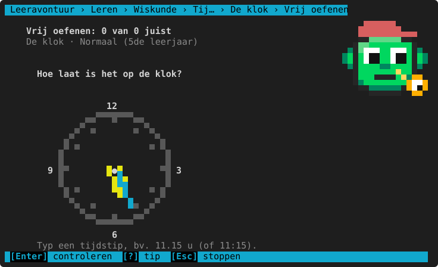

Bij "zet de klok" draait de uurwijzer vanzelf mee, zoals bij een echte klok:

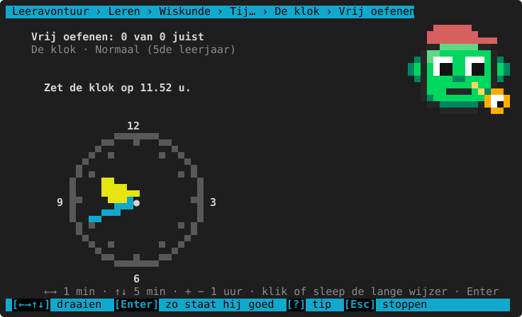

Wie "half vier" leest als 4.30, krijgt uitleg: in het Vlaams is half vier een half uur **vóór** vier.

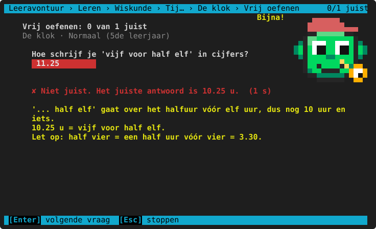

Zonder kleur of in ASCII ziet de klok er zo uit:

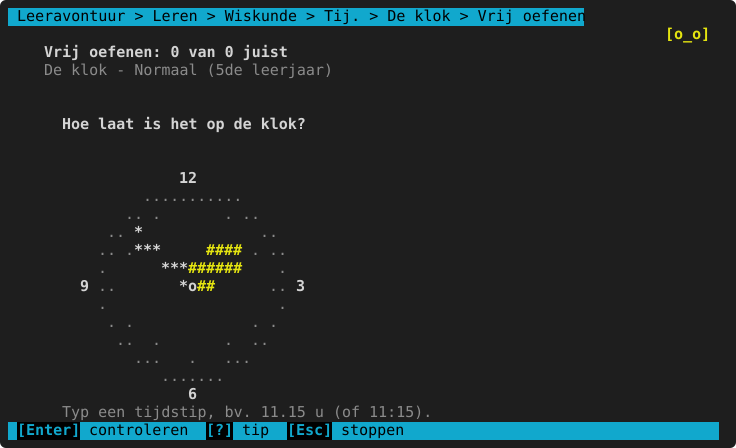

**Per leerjaar**

<!-- auto:leerlijn wiskunde.eenheden.klok -->
|  | 3de leerjaar | 4de leerjaar | 5de leerjaar | 6de leerjaar | 1ste middelbaar |
|---|---|---|---|---|---|
| **soorten vragen** | de wijzerklok lezen, woorden → cijfers, cijfers → woorden, de wijzers zetten, later | + 24 uur, vroeger | idem | idem | de wijzerklok lezen, cijfers → woorden, de wijzers zetten, 24 uur, later, vroeger |
| **minuten (lezen) in stappen van** | 5 | 1 | idem | idem | idem |
| **later/vroeger: hoogstens (minuten)** | 60 | 120 | 180 | 240 | 300 |
| **ook over middernacht** | nee | idem | idem | ja | idem |
<!-- /auto -->

**Herkende denkfouten**

<!-- auto:denkfouten wiskunde.eenheden.klok -->
- uurwijzer en minutenwijzer verwisseld
- 'half vier' gelezen als 4.30 (half vier = 3.30)
- het volgende uur genomen (de uurwijzer staat er nog maar bijna)
- in 24 uur: 12 niet (of te veel) bij het uur opgeteld
- 60 minuten niet omgezet in een uur
- later en vroeger verwisseld
- gerekend alsof een uur 100 minuten heeft
<!-- /auto -->

**Spiekbrief van de klok**

<!-- auto:spiekbrief wiskunde.eenheden.klok -->
```text
DE WIJZERKLOK
  De korte wijzer = het uur.  De lange wijzer = de minuten.
  Staat de korte wijzer tussen 3 en 4? Dan is het nog 3 uur (en iets).
  De lange wijzer op 1 = 5 minuten, op 2 = 10, op 3 = 15 … (tel per 5).

IN WOORDEN
  3.00 drie uur          3.30 half vier  (half vóór vier!)
  3.05 vijf over drie    3.35 vijf over half vier
  3.15 kwart over drie   3.40 tien over half vier
  3.20 tien voor half vier   3.45 kwart voor vier
  3.25 vijf voor half vier   3.55 vijf voor vier

24 UUR
  Na de middag tel je 12 bij het uur: 3.15 's middags = 15.15 u.
  00.00 u = middernacht   12.00 u = de middag

LATER EN VROEGER
  Een uur heeft 60 minuten! Tel in stapjes tot het volle uur.
  8.50 + 20 min: tot 9.00 is 10 min, nog 10 → 9.10.
  9.10 − 25 min: terug tot 9.00 is 10 min, nog 15 terug → 8.45.
```
<!-- /auto -->

Tijd zit ook in de [vraagstukken](vraagstukken.md): een tijdsduur, een aankomstuur of een vertrekuur, met
kloktijden in het klad (`9.45 u + 35 min = 10.20 u`).

## Geld

Euro ↔ cent, wisselgeld ("Je betaalt met € 20. Hoeveel krijg je terug?") en vanaf het 4de wat je samen betaalt
voor een paar stuks fruit. Typ het bedrag met een komma (`8,80`); een `€` ervoor mag.

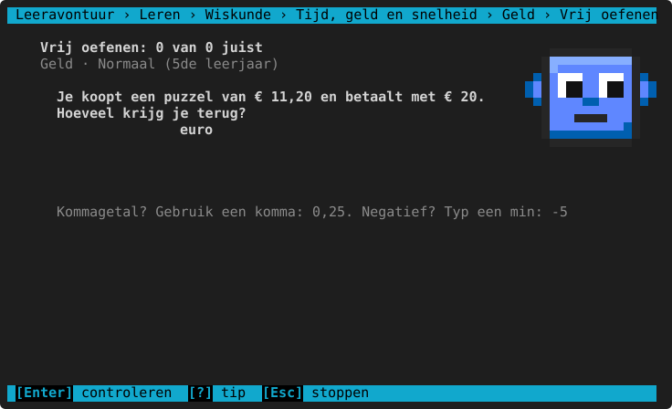

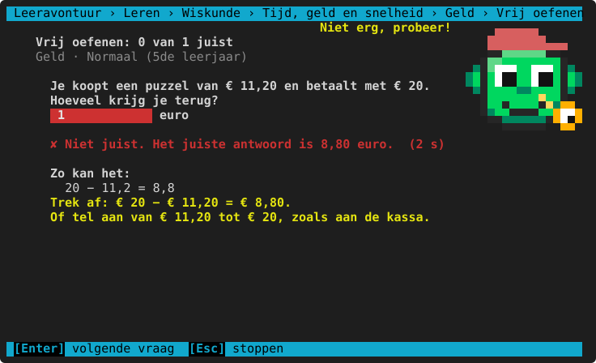

**Per leerjaar**

<!-- auto:leerlijn wiskunde.eenheden.geld -->
|  | 3de leerjaar | 4de leerjaar | 5de leerjaar | 6de leerjaar | 1ste middelbaar |
|---|---|---|---|---|---|
| **soorten vragen** | euro → cent, cent → euro, wisselgeld | + samen betalen | idem | idem | idem |
| **bedragen tot (cent)** | 999 | 2000 | 9999 | idem | idem |
<!-- /auto -->

**Herkende denkfouten**

<!-- auto:denkfouten wiskunde.eenheden.geld -->
- de komma verkeerd: 1 euro = 100 cent
- opgeteld in plaats van afgetrokken
<!-- /auto -->

## Snelheid

Vanaf het 6de leerjaar: afstand = snelheid × tijd, tijd = afstand : snelheid, snelheid = afstand : tijd, met
fietsers, auto's, treinen en wandelaars. In het 1ste middelbaar ook km/u ↔ m/s (× of : 3,6). De uitleg zet de
minuten eerst om in uren (30 min = 0,5 u).

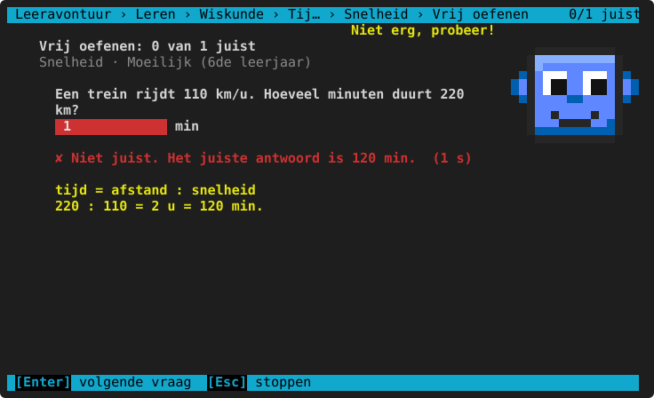

**Per leerjaar**

<!-- auto:leerlijn wiskunde.eenheden.snelheid -->
|  | 3de leerjaar | 4de leerjaar | 5de leerjaar | 6de leerjaar | 1ste middelbaar |
|---|---|---|---|---|---|
| **soorten vragen** | — | — | — | afstand, tijd, snelheid | + km/u ↔ m/s |
| **tijden (minuten)** | — | — | — | 30, 60, 90, 120, 180 | + 15, 45, 150 |

— = komt nog niet aan bod in het 3de leerjaar, 4de leerjaar en 5de leerjaar: dat niveau kun je dan niet kiezen (er staat "nog niet in dit leerjaar").
<!-- /auto -->

**Herkende denkfouten**

<!-- auto:denkfouten wiskunde.eenheden.snelheid -->
- vermenigvuldigd in plaats van gedeeld (of omgekeerd)
- minuten niet omgezet in uren
- bij km/u en m/s de verkeerde kant op met 3,6
<!-- /auto -->

## Spiekbrief

<!-- auto:spiekbrief wiskunde.eenheden.tijd -->
```text
TIJD
  1 u = 60 min     1 min = 60 s     1 dag = 24 u
  1 week = 7 dagen     1 jaar = 12 maanden
  Een uur heeft 60 minuten, geen 100!
  135 min = 2 u 15 min  (2 × 60 = 120, en nog 15)
  Tijdsduur: tel in stapjes tot het volle uur.
  8.45 u → 9.00 u = 15 min, 9.00 u → 10.20 u = 1 u 20 min, samen 1 u 35 min

GELD
  1 euro = 100 cent      € 3,45 = 345 cent      275 cent = € 2,75
  Wisselgeld = wat je betaalt − de prijs.  € 20 − € 12,35 = € 7,65

SNELHEID  (6de leerjaar)
  afstand = snelheid × tijd      tijd = afstand : snelheid
  snelheid = afstand : tijd
  60 km/u = 60 km in 1 uur.  30 min = 0,5 u   15 min = 0,25 u
  1 m/s = 3,6 km/u   (van km/u naar m/s: : 3,6)
```
<!-- /auto -->

> **Voor het kind:** Een uur heeft 60 minuten, geen 100! Tel in stapjes tot het volle uur: 8.45 u → 9.00 u is
> 15 minuten.
