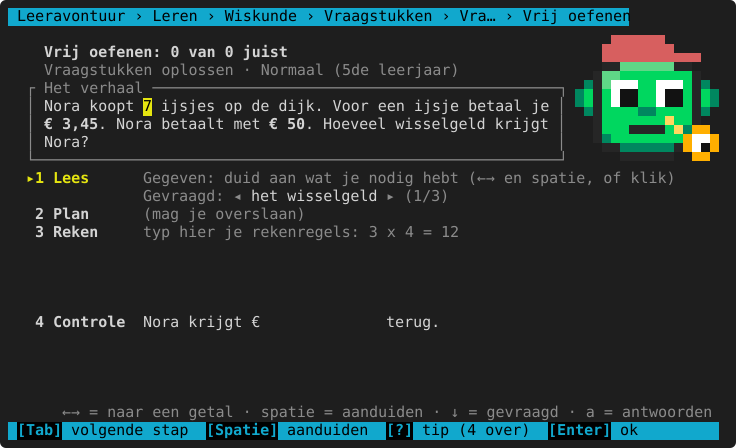
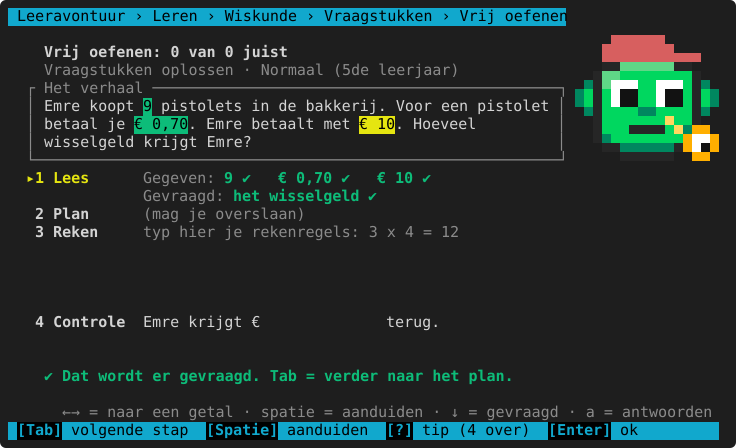
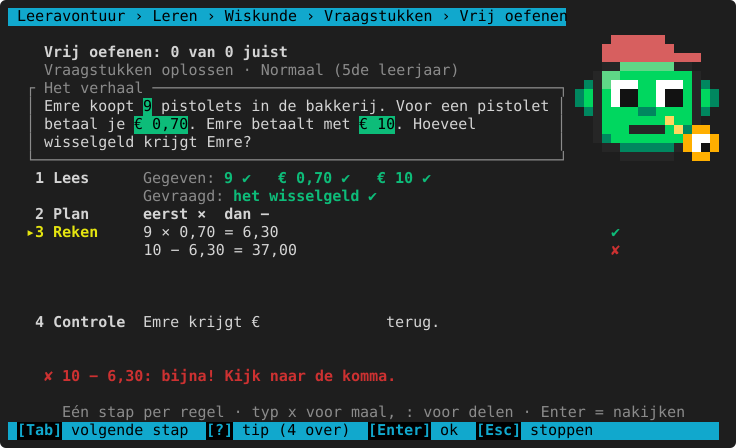
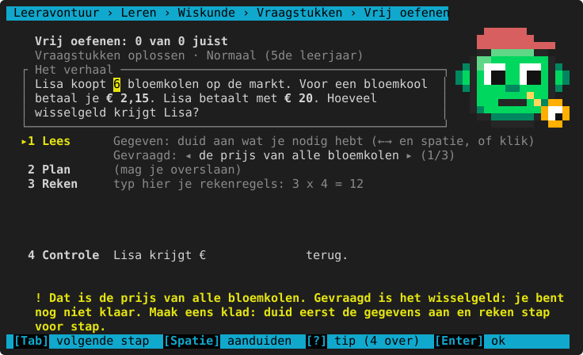
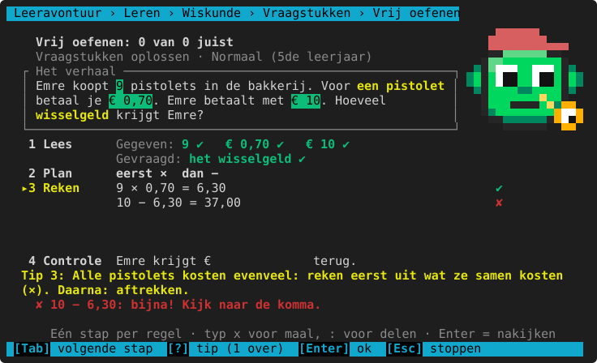
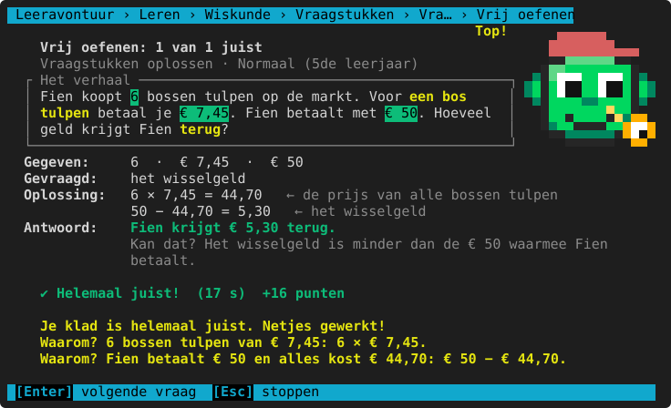
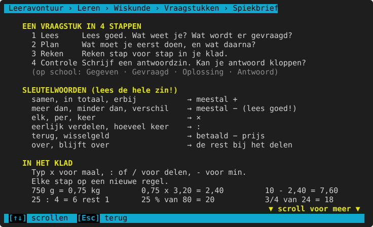

# Vraagstukken

**Waar:** Leren & oefenen → Wiskunde → **Vraagstukken** · [← terug naar de inhoud](../README.md)

Bij een vraagstuk moet een kind eerst **lezen en denken**, dan pas rekenen: wat weet ik, wat wordt er gevraagd,
welke bewerking hoort erbij, en kan mijn antwoord kloppen? Het programma volgt daarvoor **4 stappen**. Daarin
zit het Vlaamse schema **Gegeven · Gevraagd · Oplossing · Antwoord**.

| Stap | Wat het kind doet | Op het scherm |
|---|---|---|
| **1 Lees** | de getallen aanduiden die nodig zijn, en kiezen wat er gevraagd wordt | Gegeven en Gevraagd |
| **2 Plan** | de bewerkingen in volgorde zetten: eerst ×, dan − (mag overgeslagen worden) | Welke bewerking? |
| **3 Reken** | rekenregels typen in het klad; elke regel wordt meteen nagekeken | Oplossing |
| **4 Controle** | het antwoord invullen in de antwoordzin; het programma kijkt of het kan kloppen | Antwoord |



> **Andere woorden op school?** De namen van de stappen staan in `leeravontuur/inhoud/vraagstukken/zinnen.json`
> (`stappenplan`). Pas ze aan naar de woorden van de juf of meester.

## Bedienen

- **Tab** gaat naar de volgende stap, **Shift+Tab** naar de vorige. Je kan ook op een stap klikken.
- **Stap 1:** met ← → spring je naar een getal in het verhaal, met **spatie** duid je het aan (of klik erop). Het
  komt bij *Gegeven*, met ✔ als je het nodig hebt en "(niet nodig)" als het een overbodig gegeven is.
  Met ↓ ga je naar *Gevraagd*: kies met ← → en spatie wat er gevraagd wordt (er zijn 3 keuzes).
- **Stap 2:** typ `+` `-` `x` `:` of `o` (omzetten) in de volgorde waarin je ze nodig hebt, of klik op de knoppen.
- **Stap 3:** typ een rekenregel en druk Enter. **Een speciaal teken typen hoeft niet**: `x` of `*` voor maal, `:`
  of `/` voor delen, `-` voor min. Het klad toont de regel daarna netjes met × : −.
- **Stap 4:** typ het antwoord (een getal, met een komma) en druk Enter. Met **`a`** spring je vanuit stap 1
  meteen naar het antwoord.
- Een getal typen in stap 1 of 2 springt meteen naar het klad.



## Het klad

Het klad leest wat een kind op papier zou schrijven:

| Typ bv. | Wat het is |
|---|---|
| `3 x 2,15 = 6,45` | een bewerking (ook `3*2,15=6,45`) |
| `20 - 6,45 = 13,55` | aftrekken (het klad toont `20 − 6,45 = 13,55`) |
| `750 g = 0,75 kg` | omzetten (ook `2 u 15 min = 135 min`, `€ 3,50 = 350 cent`) |
| `25 : 4 = 6 rest 1` | delen met een rest (ook `6 r 1`) |
| `25 % van 80 = 20` | procent van (ook `3/4 van 24 = 18`) |
| `(3 + 5) x 2 = 16` | met haakjes |
| `kersen: 0,75 x 3,20 = 2,40` | met een woord ervoor (dat telt niet mee) |

Elke regel krijgt meteen ✔ (klopt) of ✘ (rekenfout). De melding zegt **wat** er mis is, maar nooit het juiste getal:
"bijna! Kijk naar de komma", "je schreef ×, maar je rekende +", "reken 28 × 2 nog eens na".



Na het antwoord vergelijkt het programma het hele klad met de juiste stappen én met de bekende **foute paden**.
Het zegt dan in welke regel het eerst misliep ("Regel 1: je vergat 750 g eerst om te zetten naar kg").
Een andere juiste weg is geen fout: `19 + 9 + 19 + 9 = 56` is even goed als `19 + 9 = 28` en `28 × 2 = 56`.

## Meteen antwoorden mag

Een kind dat het in zijn hoofd kan, mag meteen antwoorden (`a`).

- **Juist:** top, met extra punten.
- **Fout:** het krijgt **één tweede kans**. Is de denkfout te herkennen, dan zegt het programma ze ("Dat is de prijs
  van alle bloemkolen. Gevraagd is het wisselgeld: je bent nog niet klaar."), en het vraagt om klad te maken.
- Pas juist na die tweede kans: de helft van de punten, en het vraagstuk komt in de herhaalbak.



## Tips: telkens een beetje meer, nooit het antwoord

Met **`?`** krijgt het kind de volgende tip (er zijn er 4):

1. De **sleutelwoorden** (*elke*, *samen*, *terug*, *per* …) en de getallen die je nodig hebt, lichten op in het
   verhaal. De overbodige getallen worden grijs.
2. **Wat er gevraagd wordt**, met de eenheid.
3. **Welke bewerkingen**, in woorden en zonder getallen ("Alle bloemkolen kosten evenveel: reken eerst uit wat
   ze samen kosten (×). Daarna: aftrekken.").
4. Hulp bij **de plek waar het misloopt**: de eerste foute regel in het klad, een getal dat nog niet is
   aangeduid, of de stap die nog ontbreekt.



Elke tip kost een beetje punten; zonder tip zijn er extra punten (zie [Punten](#punten)). Het aantal tips staat in
het rapport.

## Na het nakijken

Het programma toont de **uitgewerkte oplossing** in het GGOA-schema: de gegevens (en welk gegeven niet nodig was),
wat er gevraagd werd, de stappen met wat je ermee vindt, de antwoordzin en een **controle** ("Kan dat? Het wisselgeld
is minder dan de € 20 waarmee Lisa betaalt."). Daaronder staat de motivering, ook bij een juist antwoord.



## Hoe de verhalen gemaakt worden

Elk vraagstuk is een mengsel van vier stukken. Daardoor zijn er duizenden verschillende verhalen, en leert een kind de
**rekenstructuur** herkennen in plaats van een verhaaltje van buiten:

| Stuk | Voorbeeld | Waar |
|---|---|---|
| **rekenstructuur** | groepjes: aantal × per groepje | `kern/wiskunde/vraagstukken.py` |
| **wereld** | de bakker met platen broodjes, de metselaar met rijen bakstenen, de boer met kratten appels | `inhoud/vraagstukken/werelden.json` |
| **verwoording** | "Op elke plaat liggen 24 broodjes." of "Er liggen 24 broodjes op elke plaat." | `inhoud/vraagstukken/zinnen.json` |
| **getallen** | mooi gekozen per leerjaar, binnen realistische grenzen (een brood kost € 2–4) | de leerlijn |

- Er zijn 13 rekenstructuren met elk 1–3 varianten (ook **omgekeerde vragen**), en 16 werelden.
- De volgorde van de zinnen wisselt soms.
- Vanaf het 3de leerjaar duikt er soms een **overbodig gegeven** op ("De bakker begint om 5 uur."), vaker in hogere
  leerjaren.
- **Herhalen** betekent: dezelfde rekenstructuur in een **andere wereld**. Een kind dat bij de bakker de fout in
  ging, krijgt later hetzelfde soort vraagstuk bij de metselaar of de boer.
- Een ouder kan een wereld toevoegen in `werelden.json` (woorden als `enkelvoud|meervoud|lidwoord`, bereiken als
  `[min, max]`). Een test controleert dat elk verhaal klopt, mooi uitkomt en in het kader past.

**Per leerjaar**

<!-- auto:leerlijn wiskunde.vraagstukken.oplossen -->
|  | 3de leerjaar | 4de leerjaar | 5de leerjaar | 6de leerjaar | 1ste middelbaar |
|---|---|---|---|---|---|
| **soorten vraagstukken** | samen (+), het ontbrekende deel (−), hoeveel meer? (−), zoveel meer: hoeveel? (+), groepjes: hoeveel in totaal? (×), eerlijk verdelen (:), hoeveel groepjes? (:), hoeveel volle? (: met rest), wat blijft er over? (de rest), wisselgeld (−) | + hoeveel nodig? (naar boven afronden), samen en dan verdelen (+ :), wisselgeld bij meer stuks (× −), een breuk van een aantal (: ×), sparen: hoeveel weken? (− : naar boven), recept voor meer of minder personen (: ×) | het ontbrekende deel (−), hoeveel meer? (−), zoveel meer: hoeveel? (+), 'minder dan' maar optellen (valkuil), groepjes: hoeveel in totaal? (×), eerlijk verdelen (:), hoeveel groepjes? (:), wat blijft er over? (de rest), hoeveel nodig? (naar boven afronden), samen en dan verdelen (+ :), wisselgeld bij meer stuks (× −), twee soorten kopen (× × +), prijs per kg (omzetten, ×), prijs met korting (% −), hoeveel korting? (%), sparen: hoeveel weken? (− : naar boven), recept voor meer of minder personen (: ×), een breuk van een aantal (: ×), het andere deel (: × −), omtrek: een hek rondom (+ ×) | het ontbrekende deel (−), zoveel meer: hoeveel? (+), 'minder dan' maar optellen (valkuil), eerlijk verdelen (:), hoeveel groepjes? (:), hoeveel nodig? (naar boven afronden), samen en dan verdelen (+ :), wisselgeld bij meer stuks (× −), twee soorten kopen (× × +), twee soorten en wisselgeld (4 stappen), prijs per kg (omzetten, ×), prijs per kg en wisselgeld (3 stappen), prijs met korting (% −), hoeveel korting? (%), sparen: hoeveel weken? (− : naar boven), recept voor meer of minder personen (: ×), een breuk van een aantal (: ×), het andere deel (: × −), omtrek: een hek rondom (+ ×), omtrek en prijs (+ × ×) | 'minder dan' maar optellen (valkuil), hoeveel groepjes? (:), hoeveel nodig? (naar boven afronden), samen en dan verdelen (+ :), twee soorten en wisselgeld (4 stappen), prijs per kg en wisselgeld (3 stappen), prijs met korting (% −), hoeveel korting? (%), sparen: hoeveel weken? (− : naar boven), recept voor meer of minder personen (: ×), het andere deel (: × −), omtrek en prijs (+ × ×) |
| **getallen tot** | 1000 | 10 000 | 100 000 | 1 000 000 | idem |
| **groepjes, stuks of keer: hoogstens** | 10 | 12 | 20 | 25 | 30 |
| **prijzen in stappen van (€)** | 1 | 0,5 | 0,05 | idem | 0,01 |
| **gewichten in stappen van (g)** | — | idem | 250 | 50 | idem |
| **procent korting** | — | idem | 10, 20, 25, 50 | + 5, 15, 30, 40, 75 | 5, 12, 15, 20, 25, 30, 35, 40, 60, 75 |
| **noemers** | — | 2, 3, 4, 5, 10 | + 8 | + 6 | 3, 4, 5, 6, 8, 10, 12 |
| **kans op een overbodig gegeven** | 15 % | 25 % | 35 % | 45 % | 50 % |
| **kans op een inleidende zin** | 30 % | idem | 25 % | 20 % | idem |
<!-- /auto -->

**Herkende denkfouten**

Ze worden niet per verhaal geschreven, maar komen automatisch uit de stappen van de oplossing. Zo werken ze bij elk
verhaal.

<!-- auto:denkfouten wiskunde.vraagstukken.oplossen -->
- niet (goed) omgezet naar de juiste eenheid
- een overbodig gegeven gebruikt
- een stap vergeten
- gestopt na een tussenstap
- 10, 100 of 1000 keer te groot of te klein (komma of eenheid)
- de laatste (niet volle) meegeteld
- het aantal keer gegeven in plaats van de rest
- het procent als gewoon getal gebruikt
- het procent gelezen als euro
- de oppervlakte berekend in plaats van de omtrek
- 'minder' gelezen als aftrekken (het verhaal zegt iets anders)
- een rekenfout in het klad
- een antwoord dat niet kan kloppen
- opgeteld in plaats van afgetrokken
- opgeteld in plaats van vermenigvuldigd
- opgeteld in plaats van gedeeld
- afgetrokken in plaats van opgeteld
- afgetrokken in plaats van vermenigvuldigd
- afgetrokken in plaats van gedeeld
- vermenigvuldigd in plaats van opgeteld
- vermenigvuldigd in plaats van afgetrokken
- vermenigvuldigd in plaats van gedeeld
- gedeeld in plaats van opgeteld
- gedeeld in plaats van afgetrokken
- gedeeld in plaats van vermenigvuldigd
<!-- /auto -->

## Punten

| | Punten |
|---|---|
| juist | 2 × de gewone punten (op het eigen niveau: 20) |
| per tip | −3 (maar minstens 5) |
| zonder tip | +5 |
| het klad helemaal juist | +5 |
| pas juist na de tweede kans | de helft |

## Wat de ouder ziet

In het [rapport](../ouderdeel.md) staat per periode, bij *Vraagstukken oplossen*: het gemiddeld aantal tips, hoeveel
er juist waren zonder tip, hoeveel meteen juist en hoeveel met klad (en hoeveel daarvan helemaal juist). De
denkfouten uit het klad tellen mee bij *Meest gemaakte denkfouten*.

## Spiekbrief



<!-- auto:spiekbrief wiskunde.vraagstukken.oplossen -->
```text
EEN VRAAGSTUK IN 4 STAPPEN
  1 Lees     Lees goed. Wat weet je? Wat wordt er gevraagd?
  2 Plan     Wat moet je eerst doen, en wat daarna?
  3 Reken    Reken stap voor stap in je klad.
  4 Controle Schrijf een antwoordzin. Kan je antwoord kloppen?
  (op school: Gegeven · Gevraagd · Oplossing · Antwoord)

SLEUTELWOORDEN (lees de hele zin!)
  samen, in totaal, erbij           → meestal +
  meer dan, minder dan, verschil    → meestal − (lees goed!)
  elk, per, keer                    → ×
  eerlijk verdelen, hoeveel keer    → :
  terug, wisselgeld                 → betaald − prijs
  over, blijft over                 → de rest bij het delen

IN HET KLAD
  Typ x voor maal, : of / voor delen, - voor min.
  Elke stap op een nieuwe regel.
  750 g = 0,75 kg         0,75 x 3,20 = 2,40         10 - 2,40 = 7,60
  25 : 4 = 6 rest 1       25 % van 80 = 20           3/4 van 24 = 18

KAN DAT KLOPPEN?
  Wisselgeld is minder dan wat je betaalt.
  Een deel is minder dan het geheel.
  Schat eerst: 0,75 kg van € 3,20 is iets minder dan € 3,20.
  Zet de eenheid erbij: € 7,60 — niet 760 en niet 7600.
```
<!-- /auto -->

> **Voor het kind:** Lees de hele zin, niet alleen de getallen. "Minder dan" betekent niet altijd min! Schrijf elke
> stap op een nieuwe regel, en kijk op het einde: kan dat kloppen?
