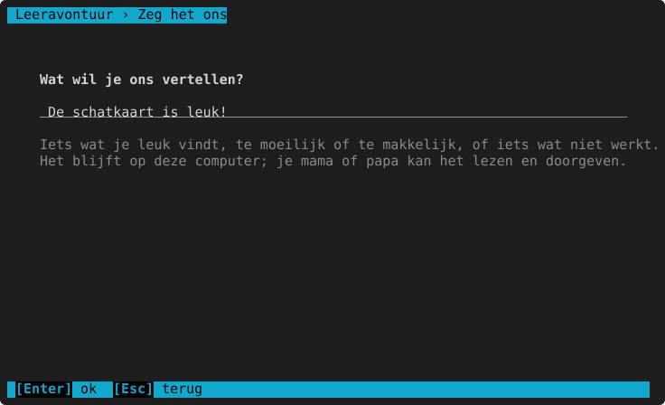
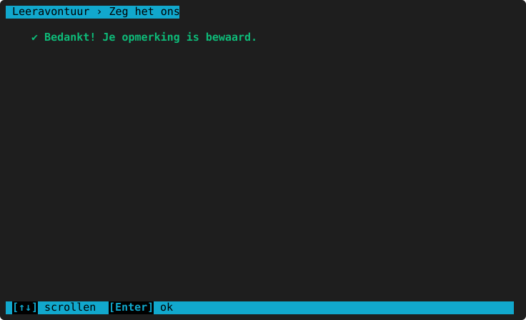

# Zeg het ons

**Waar:** hoofdmenu → **9. Zeg het ons** · [← terug naar de inhoud](README.md)

Het kind (of de ouder) schrijft wat leuk is, te moeilijk of te makkelijk, of wat niet werkt. Typ je opmerking
(hoogstens 70 tekens; alle letters, cijfers en leestekens mogen) en druk Enter. `Esc` = toch niets bewaren.

De opmerking blijft **op de computer**: niets wordt verstuurd. Ze komt in het bestand `feedback.txt` in de
gegevensmap (zie [Problemen oplossen](problemen-oplossen.md#waar-staan-de-gegevens)), met de datum, de naam van het
kind en waar het was. De ouder leest alles in het [ouderdeel](ouderdeel.md#opmerkingen) → **Opmerkingen** en kan het
doorgeven aan wie het programma maakt.

> **Voor het kind:** Vind je iets saai, te moeilijk of kapot? Schrijf het hier. Zo wordt het programma beter.
